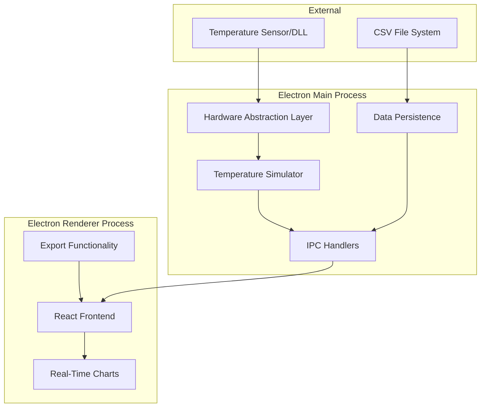

# Temperature Plotter (v1.0.0)


A real-time industrial temperature monitoring application built with Electron, React, and Node.js.

## Project Overview

This application provides a "Vertical Slice" solution for reading, visualising, and logging temperature sensor data. It features a robust IPC (Inter-Process Communication) architecture that bridges a Node.js backend (handling hardware/simulation) with a React frontend (handling visualisation).

**Key Capabilities:**
- Real-Time Visualisation: Live graphing of sensor data (1Hz refresh rate) using Recharts
- Persistent Telemetry: Background logging to temperature_telemetry.csv ensures data is never lost
- Data Export: On-demand CSV export for reporting and analysis
- Hardware Abstraction: Ready for seamless DLL integration with fallback simulation mode

## Quick Installation

### End Users
1. Navigate to: `out/make/squirrel.windows/x64/`
2. Double-click `TemperaturePlotterSetup.exe`
3. Application installs and launches automatically
4. Desktop shortcut created for easy access

### Developers
```bash
git clone <repository-url>
cd temperature-plotter
npm install
npm start
```

## Development Commands

```bash
# Start development server
npm start

# Run tests (79 tests, 100% pass rate)
npm test

# Build application
npm run make

# Package for distribution
npm run package
```

## High-Level Architecture



**Architecture Highlights:**
- **Main Process**: Hardware interaction, data processing, file system access
- **Renderer Process**: UI rendering, user interaction, data presentation  
- **Security Layer**: contextBridge prevents XSS and unauthorised API access

## Testing

Comprehensive Jest test suite with 79 tests achieving 100% pass rate:
- Unit Tests: Core module testing
- Integration Tests: End-to-end workflow validation
- Component Tests: React component testing
- DLL Binding Tests: Native library integration

*For detailed testing strategy and coverage reports, see [System Architecture](docs/SYSTEM-ARCHITECTURE.md)*

## Technical Specifications

**Dependencies:**
- Electron: Cross-platform desktop framework
- React: User interface library
- Recharts: Data visualisation
- Tailwind CSS: Utility-first CSS framework
- Jest: JavaScript testing framework
- Koffi: Foreign Function Interface for DLL binding

**Performance:**
- Data Rate: 1Hz temperature updates
- Response Time: <100ms UI update latency
- Memory Usage: Optimised for 24/7 operation
- Data Integrity: 100% telemetry persistence

## Documentation

### Architecture & Design
**[docs/SYSTEM-ARCHITECTURE.md](docs/SYSTEM-ARCHITECTURE.md)** - Complete technical documentation with:
- 12 detailed Mermaid diagrams covering all system aspects
- Component architecture with security layers
- Design rationale with KSB evidence mapping
- User stories with acceptance criteria
- Testing and deployment strategies

### Developer Resources
- **[docs/API.md](docs/API.md)** - Comprehensive API reference
- **[docs/CONTRIBUTING.md](docs/CONTRIBUTING.md)** - Development guidelines
- **[docs/CHANGELOG.md](docs/CHANGELOG.md)** - Version history
- **[PORTFOLIO-SUMMARY.md](PORTFOLIO-SUMMARY.md)** - Complete evidence package

### Presentation Materials
- **[PRESENTATION-SCRIPT.md](PRESENTATION-SCRIPT.md)** - Academic assessment narrative
- **[DEMO-CHECKLIST.md](DEMO-CHECKLIST.md)** - Step-by-step demonstration guide
- **[QUICK-REFERENCE.md](QUICK-REFERENCE.md)** - Technical specifications summary

## Future Enhancements

- Hardware Integration: Connect to actual temperature sensors via DLL
- Advanced Analytics: Statistical analysis and trend detection
- Alert System: Temperature threshold notifications
- Multi-Sensor Support: Expand beyond single temperature monitoring
- Web Dashboard: Browser-based monitoring interface

---

**Built with excellence for industrial temperature monitoring**
