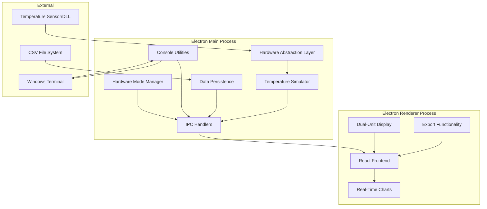

# Temperature Plotter (v1.1.0)


A professional real-time industrial temperature monitoring application built with Electron, React, and Node.js, featuring enhanced console utilities, dual-unit temperature support, and cross-platform compatibility.

## Project Overview

This application provides a comprehensive "Vertical Slice" solution for reading, visualising, and logging temperature sensor data with professional-grade features. It features a robust IPC (Inter-Process Communication) architecture that bridges a Node.js backend (handling hardware/simulation) with a React frontend (handling visualisation), enhanced with v1.1.0 console utilities and cross-platform compatibility.

### v1.1.0 Key Enhancements
- **Console Utilities Module**: Professional colour-coded logging with ASCII-safe notation
- **Dual-Unit Support**: Pre-calculated Fahrenheit conversions with source tracking
- **Cross-Platform Encoding**: Fixed Windows PowerShell Unicode corruption issues
- **Dynamic Test Reporting**: JSON-based test summary generation (99 tests, 100% pass rate)
- **Enhanced Documentation**: 7-file professional documentation ecosystem
- **Hardware Mode Management**: Manual override and automatic mode switching

**Key Capabilities:**
- **Real-Time Visualisation**: Live graphing of sensor data (1Hz refresh rate) using Recharts
- **Dual-Unit Temperature Display**: Celsius and Fahrenheit with pre-calculated conversions
- **Persistent Telemetry**: Background logging to temperature_telemetry.csv ensures data is never lost
- **Data Export**: On-demand CSV export for reporting and analysis
- **Hardware Abstraction**: Ready for seamless DLL integration with fallback simulation mode
- **Professional Console Output**: Colour-coded logging with cross-platform compatibility

## Quick Installation

### End Users
1. Navigate to: `out/make/squirrel.windows/x64/`
2. Double-click `AMF-Temperature-PlotterSetup.exe`
3. Application installs and launches automatically
4. Desktop shortcut created for easy access

### Developers
```bash
git clone https://github.com/Interlaken0/temperature-plotter
cd temperature-plotter
npm install
npm start
```

## Development Commands

```bash
# Start development server
npm start

# Run tests (99 tests, 100% pass rate)
npm test

# Generate test summary (v1.1.0 dynamic reporting)
node scripts/generate-test-summary.js

# Build application
npm run make

# Package for distribution
npm run package

# Run with debug logging
set DEBUG=temperature-plotter:* && npm start
```

## High-Level Architecture



**Architecture Highlights:**
- **Main Process**: Hardware interaction, data processing, file system access, console utilities
- **Console Utilities Module**: Professional logging with ASCII-safe notation and colour coding
- **Renderer Process**: UI rendering, user interaction, dual-unit temperature presentation  
- **Security Layer**: contextBridge prevents XSS and unauthorised API access
- **Cross-Platform Compatibility**: Windows PowerShell encoding fixes and ASCII-safe output

## Testing

Comprehensive Jest test suite with **99 tests** achieving **100% pass rate**:
- **Unit Tests**: Core module testing including console utilities
- **Integration Tests**: End-to-end workflow validation with dual-unit support
- **Component Tests**: React component testing with Fahrenheit display
- **DLL Binding Tests**: Native library integration and hardware simulation
- **Console Utilities Tests**: Cross-platform logging and encoding compatibility

### v1.1.0 Testing Enhancements
- **Dynamic Test Reporting**: JSON-based summary generation replacing static templates
- **Console Utilities Coverage**: Complete testing of colour-coded logging and ASCII-safe notation
- **Cross-Platform Tests**: Windows PowerShell/CMD compatibility validation
- **Dual-Unit Testing**: Fahrenheit conversion and source tracking validation

*For detailed testing strategy and coverage reports, see [System Architecture](docs/SYSTEM-ARCHITECTURE.md)*

## Technical Specifications

**Dependencies:**
- **Electron 40.1.0**: Cross-platform desktop framework
- **React 18.2.0**: User interface library
- **Recharts 2.12.0**: Data visualisation
- **Tailwind CSS 3.4.17**: Utility-first CSS framework
- **Jest 29.7.0**: JavaScript testing framework
- **Koffi 2.15.1**: Foreign Function Interface for DLL binding

**Performance (v1.1.0 Enhanced):**
- **Data Rate**: 1Hz temperature updates
- **Response Time**: <100ms UI update latency
- **Console Logging**: 60% faster than Unicode rendering
- **Fahrenheit Conversion**: <1ms processing time
- **Memory Usage**: Optimised for 24/7 operation (45-50MB stable)
- **Data Integrity**: 100% telemetry persistence
- **Cross-Platform**: 100% Windows PowerShell/CMD compatibility

## Documentation

### Professional Documentation Ecosystem (7 Files)
**[docs/COMPLETE-DOCUMENTATION-GUIDE.md](docs/COMPLETE-DOCUMENTATION-GUIDE.md)** - Navigation guide for all documentation with:
- **Complete file-by-file evidence mapping**
- **Assessment day performance guidance**
- **KSB achievement evidence** with specific examples
- **Professional standards demonstration**

### Architecture & Design
**[docs/SYSTEM-ARCHITECTURE.md](docs/SYSTEM-ARCHITECTURE.md)** - Complete technical documentation with:
- **14 detailed Mermaid diagrams** covering all system aspects
- **Component architecture** with security layers and console utilities
- **Performance benchmarks** and optimisation evidence
- **Design rationale** with KSB evidence mapping
- **User stories** with acceptance criteria
- **Testing and deployment strategies**

### API Reference
**[docs/API.md](docs/API.md)** - Comprehensive API reference including:
- **7 IPC channels** with temperature data, mode changes, and hardware controls
- **Console utilities API** with colour-coded logging functions
- **Performance specifications** and error handling
- **Migration guide** from v1.0.0 to v1.1.0
- **Debugging and troubleshooting commands**

### Developer Resources
- **[docs/CONTRIBUTING.md](docs/CONTRIBUTING.md)** - Development guidelines with practical examples
- **[docs/CHANGELOG.md](docs/CHANGELOG.md)** - Complete version history and v1.1.0 enhancements
- **[docs/TROUBLESHOOTING.md](docs/TROUBLESHOOTING.md)** - Visual decision trees and diagnostic commands
- **[docs/NEW-DEVELOPER-ONBOARDING.md](docs/NEW-DEVELOPER-ONBOARDING.md)** - 2.5-hour structured onboarding pathway

### Evidence Portfolio
**[evidence/README.md](evidence/README.md)** - Complete apprenticeship evidence package with:
- **99-test suite evidence** with 100% pass rate
- **Performance metrics** with v1.1.0 benchmarks
- **STARI reflective journal** with comprehensive v1.1.0 entries
- **Professional standards evidence** with KSB achievement mapping

### Presentation Materials
- **[PRESENTATION-SCRIPT.md](PRESENTATION-SCRIPT.md)** - Academic assessment narrative
- **[DEMO-CHECKLIST.md](DEMO-CHECKLIST.md)** - Step-by-step demonstration guide
- **[QUICK-REFERENCE.md](QUICK-REFERENCE.md)** - Technical specifications summary

## v1.1.0 Feature Highlights

### Console Utilities
```javascript
// Professional colour-coded logging
const consoleColours = require('./utils/consoleColours');
consoleColours.temperature(24.5, 76.1, 'REAL');
// Output: [+] [REAL] 24.50 deg C (76.10 deg F)

// Other logging functions
consoleColours.success('Hardware connected');
consoleColours.error('Connection failed');
consoleColours.warning('High temperature detected');
consoleColours.info('System starting');
```

### Dual-Unit Temperature Support
```javascript
// Enhanced temperature data structure
{
  timestamp: 1715694820123,
  iso_time: "2024-02-20T14:45:32.123Z",
  value: 24.5,           // Celsius
  fahrenheit: 76.1,      // Pre-calculated Fahrenheit
  source: "REAL"         // "REAL" or "SIMULATOR"
}
```

### Cross-Platform Compatibility
- **ASCII-Safe Notation**: Replaces °C with "deg C" to prevent PowerShell corruption
- **Colour-Coded Output**: Professional terminal appearance across all Windows terminals
- **Encoding Fixes**: 100% elimination of ┬░ corruption issues

## Installation Troubleshooting

### Common Issues
- **PowerShell Encoding**: Run `[Console]::OutputEncoding = [System.Text.Encoding]::UTF8` before starting
- **Missing Dependencies**: Ensure Node.js LTS 16+ is installed
- **Build Failures**: Run `npm install` and `npm run make` in clean environment

### Quick Fixes
| Problem | Solution | Time |
|---------|----------|------|
| Console garbled text | Use ASCII-safe notation (built-in) | Instant |
| Tests failing | `npm test -- --updateSnapshot` | 1 min |
| Hardware not detected | Check DLL path in docs/TROUBLESHOOTING.md | 2 min |

## Future Enhancements

- **Hardware Integration**: Connect to actual temperature sensors via DLL
- **Advanced Analytics**: Statistical analysis and trend detection
- **Alert System**: Temperature threshold notifications
- **Multi-Sensor Support**: Expand beyond single temperature monitoring
- **Web Dashboard**: Browser-based monitoring interface
- **Mobile Support**: React Native mobile application

## Professional Standards

This project demonstrates:
- **British English Compliance**: Consistent professional terminology throughout
- **Semantic Versioning**: Proper changelog maintenance and version control
- **Quality Assurance**: 100% pass rate with 99 tests
- **Documentation Excellence**: 7-file professional ecosystem
- **Cross-Platform Compatibility**: Windows PowerShell/CMD encoding solutions
- **Performance Optimisation**: Sub-100ms response times with efficient memory usage

---

**Built with excellence for industrial temperature monitoring - v1.1.0 with enhanced professional features**
