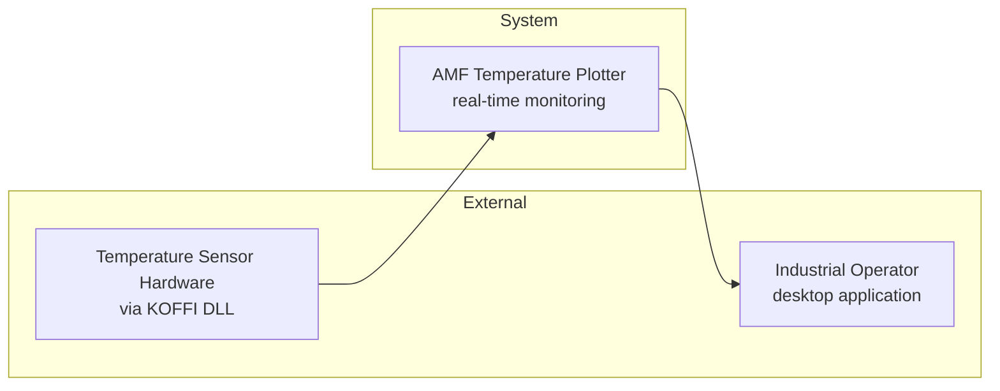
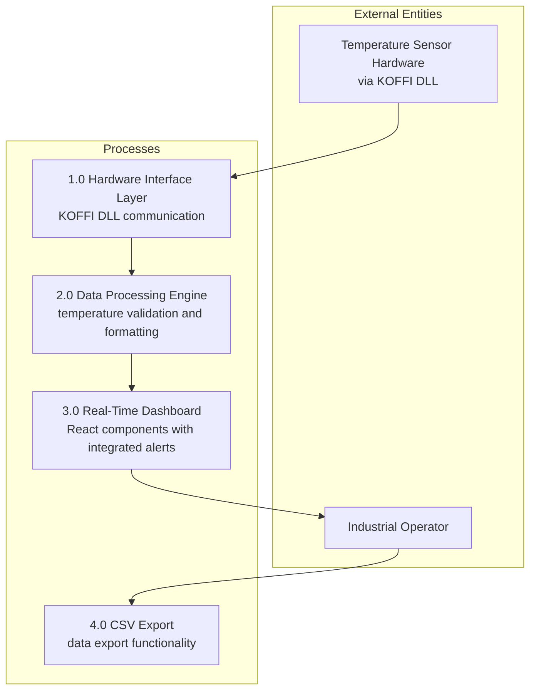

# Data Flow Diagram - AMF Temperature Plotter

## Overview
Data flow for the AMF Temperature Plotter standalone desktop application.

## System Context

## Level 1 Data Flow

## Process Descriptions

### 1.0 Hardware Interface Layer
**Description**: Manages hardware communication via KOFFI DLL.

**Input**: Raw sensor data from temperature hardware
**Output**: Validated temperature readings
**Details**: Hardware/simulation mode switching, error handling

### 2.0 Data Processing Engine
**Description**: Processes and validates temperature data.

**Input**: Temperature readings from hardware interface
**Output**: Formatted data for UI and storage
**Details**: Unit conversion, threshold comparison, data formatting

### 3.0 Real-Time Dashboard
**Description**: Displays temperature data to Industrial Operators.

**Input**: Processed temperature data
**Output**: Real-time visualisation and charts
**Details**: React components, theme management, mode switching, integrated alerts

### 4.0 CSV Export
**Description**: Handles CSV export functionality.

**Input**: Historical temperature data
**Output**: CSV files for external analysis
**Details**: Date range filtering, file generation, progress tracking

## Data Stores

### D1: In-Memory Ring Buffer
**Content**: Temperature readings with timestamps and hardware/simulation flags
**Access**: Direct JavaScript object access by temperatureStore.js and React components

### D2: Constants Module
**Content**: Buffer size (MAX_BUFFER = 5000) and configuration constants
**Access**: Direct import by components and services
