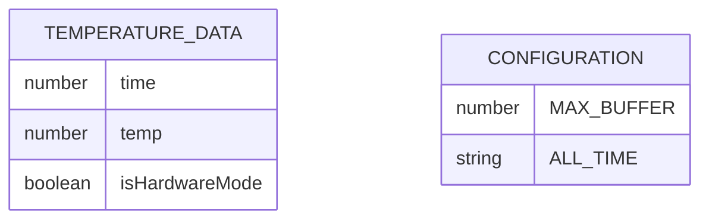

# Entity Relationship Diagram - AMF Temperature Plotter

## Overview
Data model for the AMF Temperature Plotter in-memory system.

## Entity Relationship Diagram

## Entity Definitions

### TEMPERATURE_DATA
Core temperature data structure stored in ring buffer.

**Fields**:
- `time`: Timestamp (Date.now())
- `temp`: Temperature value in degrees
- `isHardwareMode`: Boolean flag for hardware vs simulation

### CONFIGURATION
Application constants managed in constants module.

**Fields**:
- `MAX_BUFFER`: Maximum buffer size (5000 points)
- `ALL_TIME`: Special marker for unlimited historical data

## Data Storage

### Ring Buffer
**Implementation**: JavaScript Array with 5000-point capacity
**Access**: Direct object access via temperatureStore.js
**Structure**: Circular buffer with head pointer

### Constants Module
**Implementation**: ES6 module exports
**Access**: Direct import by components
**Structure**: Named constants for configuration
