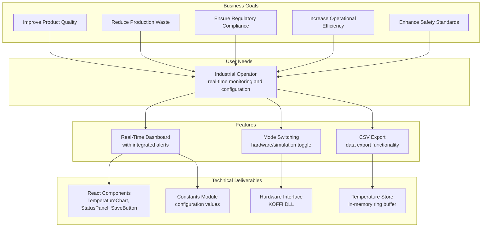

# Impact Map - AMF Temperature Plotter

## Overview
Business goals to technical deliverables for the AMF Temperature Plotter project.

## Impact Map

## Business Goals

### Improve Product Quality
Real-time monitoring and alerts to maintain optimal temperature ranges.

### Reduce Production Waste
Early detection of temperature issues to prevent material loss.

### Ensure Regulatory Compliance
Historical data analysis and CSV export for audit requirements.

### Increase Operational Efficiency
Efficient monitoring tools and integrated configuration.

### Enhance Safety Standards
Reliable alert system and continuous monitoring capabilities.

## Feature Prioritisation

### Must Have
- Real-Time Dashboard
- Mode Switching
- CSV Export

### Should Have
- Enhanced alert configurations
- Historical analysis improvements

### Could Have
- Mobile monitoring capabilities
- Advanced visualisations

### Won't Have
- Multi-user support
- Complex reporting systems
- Database storage

## User Journey

### Industrial Operator
1. Start application
2. Monitor real-time temperature
3. Switch between hardware/simulation modes
4. Export CSV data when needed
5. Configure settings as required
