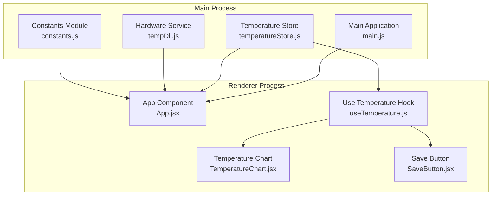

# Object Map - AMF Temperature Plotter

## Overview
Object relationships and responsibilities for the AMF Temperature Plotter Electron application.

## System Architecture

## Component Definitions

### Main Process

#### Main Application (main.js)
Electron main process managing application lifecycle and IPC communication.

#### Temperature Store (temperatureStore.js)
In-memory ring buffer for temperature data management with 5000-point capacity.

#### Hardware Service (tempDll.js)
Hardware abstraction layer for KOFFI DLL communication and sensor data.

#### Constants Module (constants.js)
Centralised configuration values for buffer sizes and system parameters.

### Renderer Process

#### App Component (App.jsx)
Root React component coordinating theme and overall application state.

#### Temperature Chart (TemperatureChart.jsx)
Real-time temperature visualisation with interactive charts and performance optimisation.

#### Save Button (SaveButton.jsx)
CSV export functionality with user feedback and accessibility features.

#### Use Temperature Hook (useTemperature.js)
Custom React hook for temperature data streaming and state management.
