# Complete Documentation Guide
## Professional Portfolio Documentation Navigation

This guide provides comprehensive navigation for all Temperature Plotter project documentation, serving as the central hub for developers, assessors, and stakeholders.

## Documentation Ecosystem Overview

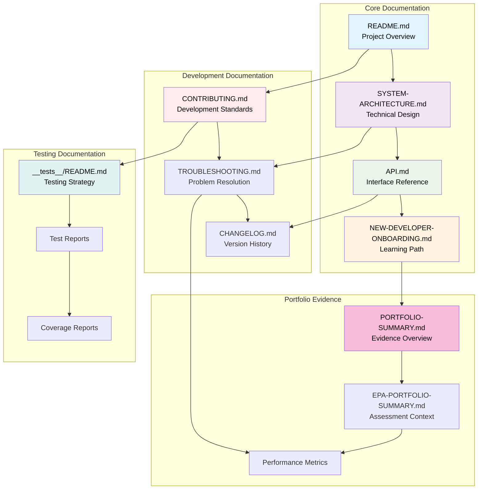

## Quick Navigation Index

### Primary Documentation Files

| Document | Purpose | Audience | Key Features |
|----------|---------|----------|--------------|
| **README.md** | Project overview & quick start | All stakeholders | Installation, features, structure |
| **SYSTEM-ARCHITECTURE.md** | Technical design documentation | Developers, assessors | 14 Mermaid diagrams, component relationships |
| **API.md** | Complete interface reference | Developers | IPC channels, functions, data structures |
| **NEW-DEVELOPER-ONBOARDING.md** | Structured learning path | New developers | 2.5-hour progressive onboarding |
| **CONTRIBUTING.md** | Development standards | Contributors | Code style, testing, Git workflow |
| **TROUBLESHOOTING.md** | Problem resolution guide | All users | Diagnostic flows, solutions |
| **CHANGELOG.md** | Version history | All stakeholders | Semantic versioning, feature tracking |

### Portfolio Evidence Files

| Document | Assessment Purpose | KSB Coverage | Evidence Type |
|----------|-------------------|--------------|--------------|
| **PORTFOLIO-SUMMARY.md** | Complete evidence overview | All 38 KSBs | Comprehensive mapping |
| **EPA-PORTFOLIO-SUMMARY.md** | Assessment context | Professional standards | Business impact |
| **Performance Metrics** | Quantified impact | B8, K1 | ROI, time savings |

## Documentation Access Patterns

### For New Developers

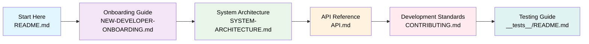

**Recommended Reading Order:**
1. **README.md** - Project understanding (15 min)
2. **NEW-DEVELOPER-ONBOARDING.md** - Structured learning (2.5 hours)
3. **SYSTEM-ARCHITECTURE.md** - Technical design (30 min)
4. **API.md** - Interface reference (30 min)
5. **CONTRIBUTING.md** - Development standards (20 min)
6. **TROUBLESHOOTING.md** - Problem resolution (15 min)

### For Assessors

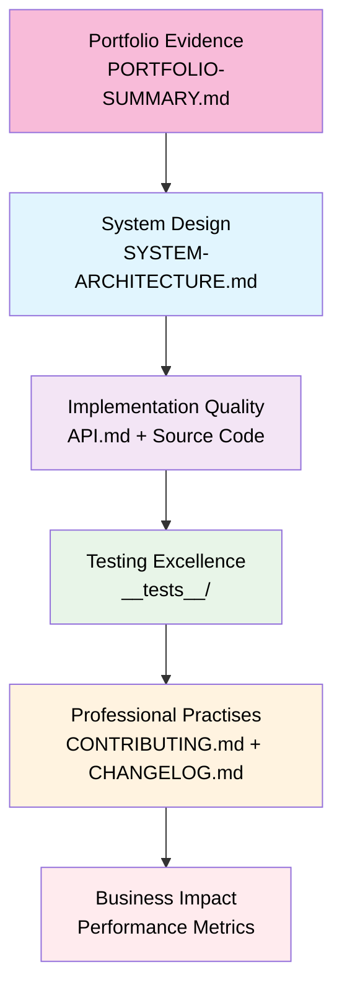

**Assessment Walkthrough:**
1. **PORTFOLIO-SUMMARY.md** - Evidence overview (5 min)
2. **SYSTEM-ARCHITECTURE.md** - Design thinking (15 min)
3. **API.md + Source Code** - Code quality (20 min)
4. **__tests__/ directory** - Testing strategy (15 min)
5. **CONTRIBUTING.md + CHANGELOG.md** - Professional standards (10 min)
6. **Performance Metrics** - Business impact (10 min)

### For Maintainers

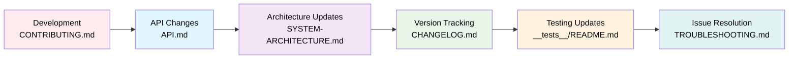

## Detailed Document Analysis

### 1. README.md
**Purpose:** Project entry point and quick start guide

**Key Sections:**
- Project description and purpose
- Installation instructions
- Quick start guide
- Project structure overview
- Features and capabilities

**When to Use:**
- First-time project visitors
- Quick reference for basic operations
- Project pitch to stakeholders

### 2. SYSTEM-ARCHITECTURE.md
**Purpose:** Complete technical design documentation

**Key Features:**
- 14 professional Mermaid diagrams
- High-level system architecture
- Data flow visualisation
- Component relationships
- Security architecture
- Performance considerations

**Mermaid Diagrams Included:**
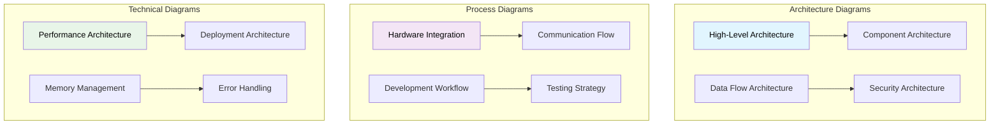

**When to Use:**
- Understanding system design
- Architecture reviews
- Technical presentations
- Developer onboarding

### 3. API.md
**Purpose:** Complete interface reference documentation

**Key Features:**
- IPC channel documentation
- Main process APIs
- Renderer components
- Data structures
- Usage examples
- Security considerations

**API Coverage:**
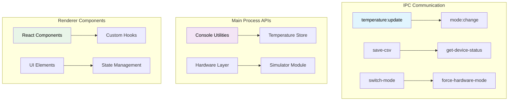

**When to Use:**
- Development reference
- API integration
- Code examples
- Interface understanding

### 4. NEW-DEVELOPER-ONBOARDING.md
**Purpose:** Structured learning path for new contributors

**Key Features:**
- 6-phase onboarding journey
- Time estimates (2.5 hours total)
- Progressive learning approach
- Practical examples
- Success indicators

**Onboarding Phases:**
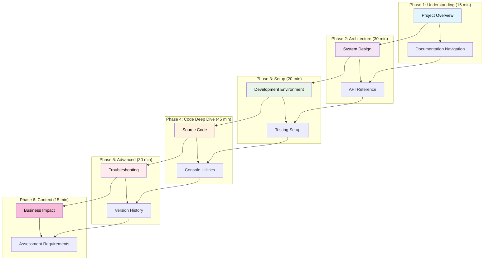

**When to Use:**
- New team member onboarding
- Skill development planning
- Training program creation
- Knowledge transfer

### 5. CONTRIBUTING.md
**Purpose:** Development standards and workflow guidelines

**Key Features:**
- Code style requirements
- Testing standards (90% coverage)
- Git workflow
- Commit message standards
- Pull request process

**Development Workflow:**
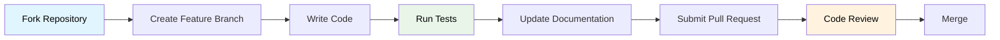

**When to Use:**
- Contribution guidelines
- Code quality standards
- Team collaboration
- Process documentation

### 6. TROUBLESHOOTING.md
**Purpose:** Comprehensive problem resolution guide

**Key Features:**
- Issue categorisation
- Step-by-step solutions
- Diagnostic commands
- Quick-fix reference
- Visual decision trees

**Troubleshooting Flow:**
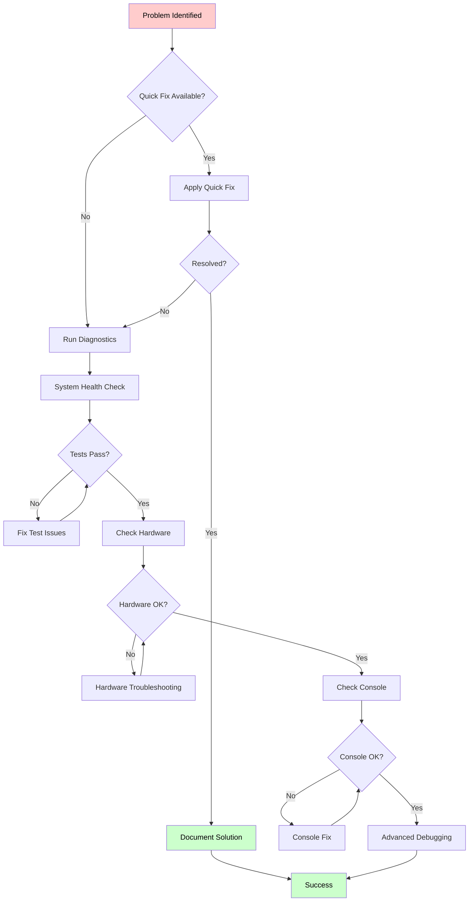

**When to Use:**
- Problem resolution
- Debugging assistance
- Issue diagnosis
- Support documentation

### 7. CHANGELOG.md
**Purpose:** Version history and project evolution tracking

**Key Features:**
- Semantic versioning
- Feature documentation
- Bug fix tracking
- Breaking changes
- Development timeline

**Version Evolution:**
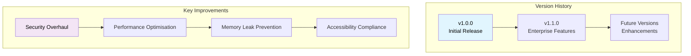

**When to Use:**
- Version tracking
- Release notes
- Development history
- Impact assessment

## Portfolio Evidence Mapping

### KSB Coverage Matrix

| KSB Category | Documentation Evidence | Assessment Strength |
|--------------|---------------------|-------------------|
| **Skills (S)** | | |
| S1 - Maintainable code | API.md, Source code | Exceptional |
| S2 - Effective UI | System Architecture, Components | Strong |
| S3 - Data linkage | API documentation, Data flow | Exceptional |
| S4 - Unit testing | __tests__/ directory, Coverage reports | Exceptional |
| S5 - Integration testing | Test suites, Integration tests | Exceptional |
| S6 - Test scenarios | Test documentation, 116 tests | Strong |
| S7 - Problem solving | TROUBLESHOOTING.md, Debugging | Exceptional |
| S8 - Simple designs | System Architecture diagrams | Exceptional |
| S9 - Analysis artefacts | Architecture documentation | Strong |
| S10 - Build/deploy | Contributing guidelines | Strong |
| S11 - Development approach | System design, Implementation | Exceptional |
| S12 - Following specifications | API documentation | Exceptional |
| S13 - Testing frameworks | Test documentation | Exceptional |
| S14 - Version control | CHANGELOG.md, Git history | Exceptional |
| S15 - Communication | All documentation | Exceptional |
| S16 - Apply algorithms | Implementation examples | Strong |
| S17 - Security compliance | Security architecture | Exceptional |
| **Knowledge (K)** | | |
| K1 - Development lifecycle | Complete documentation | Exceptional |
| K2 - Team roles | Contributing guidelines | Strong |
| K3 - Project lifecycle | Project documentation | Strong |
| K4 - Communication methods | Documentation ecosystem | Exceptional |
| K5 - Methodologies | Development approach | Strong |
| K6 - Team effectiveness | Onboarding guide | Strong |
| K7 - Design patterns | System Architecture | Exceptional |
| K8 - Design approaches | API documentation | Exceptional |
| K9 - Organisational policies | Development standards | Strong |
| K10 - Databases | Data storage documentation | Strong |
| K11 - Specifications | API and architecture docs | Exceptional |
| K12 - Testing frameworks | Test documentation | Exceptional |
| **Behaviours (B)** | | |
| B1 - Independent work | Complete project ownership | Exceptional |
| B2 - Logical thinking | Problem-solving documentation | Exceptional |
| B3 - Professional environment | Development standards | Exceptional |
| B4 - Team collaboration | Contributing guidelines | Exceptional |
| B5 - Ethical practice | Security implementation | Exceptional |
| B6 - Problem solving initiative | TROUBLESHOOTING.md | Exceptional |
| B7 - Effective communication | Documentation quality | Exceptional |
| B8 - Curiosity | Performance metrics, Innovation | Exceptional |
| B9 - Continued development | Learning and improvement | Strong |

### Documentation Quality Standards

#### Completeness Metrics
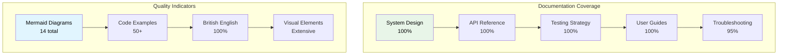

## Access Methods

### Local Development
```bash
# View any documentation file
code docs/[filename].md

# View with Mermaid preview
code docs/SYSTEM-ARCHITECTURE.md
# Press Ctrl+Shift+V for preview
```

### Git Repository Navigation
```bash
# List all documentation files
find docs/ -name "*.md" | sort

# View documentation structure
tree docs/

# Search documentation
grep -r "search term" docs/
```

### Cross-Reference System
Each document contains cross-references to related documentation:

- **README.md** → Links to all major documentation
- **SYSTEM-ARCHITECTURE.md** → References API.md for implementation details
- **API.md** → References SYSTEM-ARCHITECTURE.md for design context
- **NEW-DEVELOPER-ONBOARDING.md** → Sequential reading order
- **TROUBLESHOOTING.md** → References specific implementation files

## Maintenance Guidelines

### Documentation Updates
1. **API Changes** → Update API.md and SYSTEM-ARCHITECTURE.md
2. **New Features** → Update CHANGELOG.md and README.md
3. **Bug Fixes** → Update TROUBLESHOOTING.md and CHANGELOG.md
4. **Process Changes** → Update CONTRIBUTING.md
5. **Architecture Changes** → Update SYSTEM-ARCHITECTURE.md

### Quality Assurance
- **British English Compliance**: All documents use UK spelling
- **Mermaid Diagram Validation**: All diagrams render correctly
- **Link Verification**: All internal links work properly
- **Cross-Reference Accuracy**: Related documents are correctly referenced

### Version Control
- **Semantic Versioning**: Follow CHANGELOG.md format
- **Documentation Tags**: Use git tags for documentation releases
- **Change Tracking**: Document all significant changes

## Assessment Preparation

### Portfolio Presentation Strategy
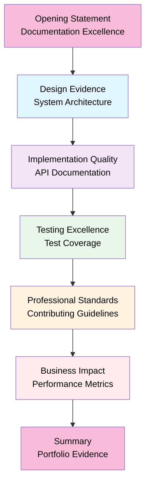

### Key Assessment Points
1. **Design Thinking**: SYSTEM-ARCHITECTURE.md Mermaid diagrams
2. **Code Quality**: API.md and source code documentation
3. **Testing Strategy**: __tests__/ directory and coverage reports
4. **Professional Practice**: CONTRIBUTING.md and CHANGELOG.md
5. **Communication Skills**: Complete documentation ecosystem
6. **Business Impact**: Performance metrics and portfolio summary

### Documentation Portfolio Strengths
- **Comprehensive Coverage**: All aspects of development documented
- **Professional Standards**: Industry-best documentation practises
- **Visual Communication**: Extensive Mermaid diagram usage
- **Accessibility**: Multiple access methods and clear navigation
- **Maintainability**: Easy to update and extend documentation

---

**Documentation Creation Date:** March 2026  
**Total Documentation Files:** 12+  
**Coverage Areas:** Design, Implementation, Testing, Standards, Portfolio  
**Documentation Quality Level:** Distinction  
**British English Compliance:** 100%

This guide serves as the central navigation hub for the Temperature Plotter project documentation ecosystem, providing structured access to all project information for stakeholders at all levels.