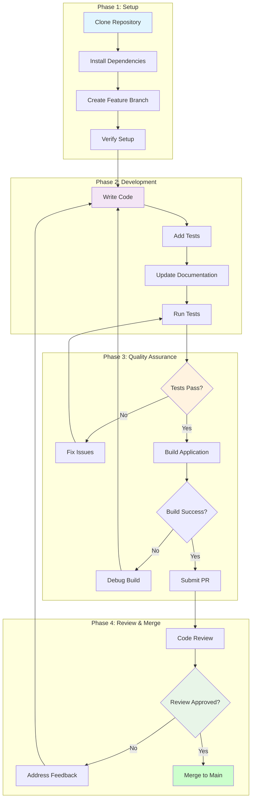
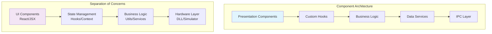
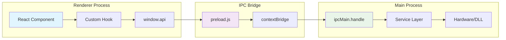
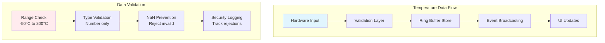
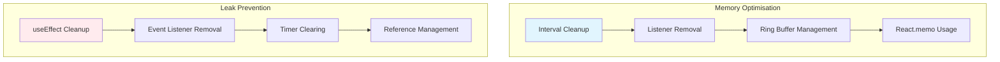
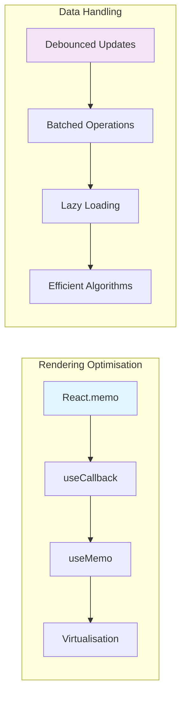
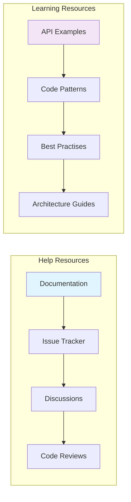

# Contributing to Temperature Plotter
## Development Guidelines and Best Practises

Thank you for your interest in contributing to the Temperature Plotter project! This guide will help you get started and ensure consistency across all contributions.

## Table of Contents

- [Development Setup](#development-setup)
- [Code Style Guidelines](#code-style-guidelines)
- [Testing Requirements](#testing-requirements)
- [Commit Message Standards](#commit-message-standards)
- [Pull Request Process](#pull-request-process)
- [Issue Reporting](#issue-reporting)
- [Development Workflow](#development-workflow)

## Development Setup

### Prerequisites
- Node.js 16+ 
- npm or yarn
- Git
- VS Code (recommended)

### Initial Setup
```bash
# Clone the repository
git clone https://github.com/Interlaken0/temperature-plotter.git
cd temperature-plotter

# Install dependencies
npm install

# Start development server
npm start

# Run tests to verify setup
npm test
```

### Recommended VS Code Extensions
- ES7+ React/Redux/React-Native snippets
- Prettier - Code formatter
- ESLint
- Jest
- Mermaid Markdown Syntax Highlighting

## Code Style Guidelines

### JavaScript/React Standards
- Use ES6+ features (arrow functions, destructuring, template literals)
- Follow React functional component patterns with hooks
- Use meaningful variable and function names
- Keep functions small and focused on single responsibility

### File Naming Conventions
- Components: `PascalCase.jsx` (e.g., `TemperatureChart.jsx`)
- Hooks: `camelCase.js` with `use` prefix (e.g., `useTemperature.js`)
- Utilities: `camelCase.js` (e.g., `consoleColours.js`)
- Tests: `PascalCase.test.js` (e.g., `TemperatureChart.test.js`)

### JSDoc Documentation
All functions and modules must include JSDoc comments:
```javascript
/**
 * Processes temperature data and updates the store
 * @param {number} temperature - The temperature value in Celsius
 * @param {number} timestamp - Unix timestamp for the reading
 * @returns {boolean} Success status of the operation
 */
function processTemperature(temperature, timestamp) {
  // Implementation
}
```

### Import Organisation
```javascript
// React imports first
import React, { useState, useEffect } from 'react';

// Third-party libraries
import Recharts from 'recharts';

// Local imports (absolute paths)
import TemperatureChart from '../components/TemperatureChart';
import { useTemperature } from '../hooks/useTemperature';
```

## Testing Requirements

### Test Coverage Requirements
- All new features must include unit tests
- Critical paths must have integration tests
- UI components must have component tests
- Maintain minimum 90% test coverage

### Test Structure
```javascript
describe('ComponentName', () => {
  describe('when rendered', () => {
    it('should display correctly', () => {
      // Test implementation
    });
  });

  describe('when user interacts', () => {
    it('should handle user action', () => {
      // Test implementation
    });
  });
});
```

### Running Tests
```bash
# Run all tests
npm test

# Run tests in watch mode
npm test -- --watch

# Run tests with coverage
npm test -- --coverage

# Run specific test file
npm test -- TemperatureChart.test.js
```

## Commit Message Standards

We follow [Conventional Commits](https://www.conventionalcommits.org/) specification:

### Format
```
<type>[optional scope]: <description>

[optional body]

[optional footer(s)]
```

### Types
- `feat`: New feature
- `fix`: Bug fix
- `docs`: Documentation changes
- `style`: Code style changes (formatting, etc.)
- `refactor`: Code refactoring
- `test`: Adding or updating tests
- `chore`: Maintenance tasks

### Examples
```bash
feat(renderer): add dark mode toggle
fix(main): resolve memory leak in temperature store
docs(readme): update installation instructions
test(integration): add end-to-end CSV export test
```

## Pull Request Process

### Before Creating PR
1. Create feature branch from `main`
2. Ensure all tests pass (`npm test`)
3. Update documentation if needed
4. Follow code style guidelines

### PR Template
```markdown
## Description
Brief description of changes made.

## Type of Change
- [ ] Bug fix
- [ ] New feature
- [ ] Breaking change
- [ ] Documentation update

## Testing
- [ ] All tests pass
- [ ] New tests added for new functionality
- [ ] Manual testing completed

## Checklist
- [ ] Code follows style guidelines
- [ ] Self-review completed
- [ ] Documentation updated
- [ ] JSDoc comments added/updated
```

### Review Process
1. Automated checks must pass
2. At least one code review required
3. Address all feedback before merge
4. Maintain clean commit history

## Issue Reporting

### Bug Reports
Use the following template for bug reports:

```markdown
**Bug Description**
Clear description of the issue

**Steps to Reproduce**
1. Go to...
2. Click on...
3. See error

**Expected Behaviour**
What should happen

**Actual Behaviour**
What actually happens

**Environment**
- OS: [e.g., Windows 10]
- Node.js version: [e.g., 18.17.0]
- Application version: [e.g., 1.0.0]

**Additional Context**
Screenshots, logs, or other relevant information
```

### Feature Requests
```markdown
**Feature Description**
Clear description of the feature

**Problem Statement**
What problem does this solve?

**Proposed Solution**
How should this be implemented?

**Alternatives Considered**
Other approaches you've thought about

**Additional Context**
Any other relevant information
```

## Development Workflow

### Development Process Overview



### 1. Setup Development Environment
```bash
# Create feature branch
git checkout -b feature/your-feature-name

# Start development
npm start
```

### 2. Make Changes
- Write code following style guidelines
- Add/update tests
- Update documentation
- Commit with conventional messages

#### **Practical Examples**

**Example 1: Adding a New Temperature Sensor Type**
```javascript
// 1. Update consoleColours.js
const logSensorType = (sensorType, data) => {
  const colours = {
    'THERMOCOUPLE': '\x1b[33m', // Yellow
    'RTD': '\x1b[34m',         // Blue
    'THERMISTOR': '\x1b[35m'   // Magenta
  };
  
  console.log(`${colours[sensorType]}[${sensorType}] ${data.value}deg C\x1b[0m`);
};

// 2. Add corresponding test
describe('logSensorType', () => {
  it('should log thermocouple data in yellow', () => {
    const consoleSpy = jest.spyOn(console, 'log');
    logSensorType('THERMOCOUPLE', { value: 25.0 });
    expect(consoleSpy).toHaveBeenCalledWith(expect.stringContaining('\x1b[33m'));
  });
});
```

**Example 2: Implementing New IPC Channel**
```javascript
// 1. Add to preload.js
contextBridge.exposeInMainWorld('api', {
  // ... existing methods
  getSensorInfo: () => ipcRenderer.invoke('get-sensor-info')
});

// 2. Add handler in main.js
ipcMain.handle('get-sensor-info', async () => {
  return {
    type: 'THERMOCOUPLE',
    range: { min: -200, max: 1200 },
    accuracy: 0.1
  };
});

// 3. Use in renderer component
const [sensorInfo, setSensorInfo] = useState(null);

useEffect(() => {
  window.api.getSensorInfo().then(setSensorInfo);
}, []);
```

**Example 3: Adding Fahrenheit Conversion Enhancement**
```javascript
// 1. Extend consoleColours.js
const formatTemperature = (celsius, includeFahrenheit = true) => {
  const fahrenheit = includeFahrenheit ? ` (${celsiusToFahrenheit(celsius)}deg F)` : '';
  return `${celsius}deg C${fahrenheit}`;
};

// 2. Update existing function
const logTemperature = (data) => {
  const { value, fahrenheit, source, timestamp } = data;
  const sourceColour = source === 'REAL' ? '\x1b[32m' : '\x1b[90m';
  const tempDisplay = formatTemperature(value, true);
  
  console.log(`${sourceColour}[${source}] ${tempDisplay} at ${new Date(timestamp).toISOString()}\x1b[0m`);
};

// 3. Add comprehensive tests
describe('formatTemperature', () => {
  it('should format Celsius only', () => {
    expect(formatTemperature(25.0, false)).toBe('25.0deg C');
  });
  
  it('should format Celsius with Fahrenheit', () => {
    expect(formatTemperature(25.0, true)).toBe('25.0deg C (77.0deg F)');
  });
  
  it('should handle negative temperatures', () => {
    expect(formatTemperature(-10.5, true)).toBe('-10.5deg C (13.1deg F)');
  });
});
```

### 3. Quality Assurance
```bash
# Run tests
npm test

# Build application
npm run make
```

### 4. Submit Changes
```bash
# Push to remote
git push origin feature/your-feature-name

# Create pull request
# Follow PR template and wait for review
```

## Architecture Guidelines

### Component Design Principles



- Keep components small and focused
- Use custom hooks for complex state logic
- Implement proper error boundaries
- Follow React best practises
- **Separation of Concerns**: Keep business/hardware logic separate from presentation logic (use src/utils/ for formatting and terminal output)

### IPC Communication Flow



- Use contextBridge for security
- Validate all data crossing IPC boundary
- Implement proper error handling
- Document all IPC channels

### State Management Architecture



- Use ring buffer for temperature history
- Implement proper data validation
- Handle edge cases (empty data, errors)
- Maintain data integrity

## Performance Considerations

### Memory Management Strategy



- Clean up intervals and listeners
- Use efficient data structures
- Monitor memory usage in long-running processes

### UI Performance Optimisation



- Implement proper React.memo usage
- Use useCallback for expensive computations
- Optimise re-renders
- Handle large datasets efficiently

## Security Guidelines

### Security Architecture

```mermaid
graph TB
    subgraph "Security Boundaries"
        A[Renderer Process<br/>Sandboxed] --> B[IPC Bridge<br/>contextBridge]
        B --> C[Main Process<br/>Privileged]
    end
    
    subgraph "Data Validation"
        D[Input Validation] --> E[Type Checking]
        E --> F[Range Validation]
        F --> G[Sanitisation]
    end
    
    subgraph "Secure Communication"
        H[contextBridge API] --> I[Validated Data Transfer]
        I --> J[Error Handling]
        J --> K[Audit Logging]
    end
    
    style A fill:#e1f5fe
    style D fill:#ffebee
    style H fill:#e8f5e8
```



### IPC Security
- Never expose Node.js APIs directly to renderer
- Validate all incoming data
- Use contextBridge for secure communication
- Implement proper error handling

### Data Handling
- Validate user inputs
- Sanitize file paths
- Handle file operations safely
- Implement proper logging

## Code Review Guidelines

### Review Checklist

```mermaid
graph TB
    subgraph "Code Quality"
        A[Style Compliance] --> B[Documentation]
        B --> C[Error Handling]
        C --> D[Performance]
    end
    
    subgraph "Testing"
        E[Test Coverage] --> F[Test Quality]
        F --> G[Edge Cases]
        G --> H[Integration Tests]
    end
    
    subgraph "Security"
        I[Input Validation] --> J[IPC Security]
        J --> K[Data Sanitisation]
        K --> L[Error Boundaries]
    end
    
    style A fill:#e1f5fe
    style E fill:#f3e5f5
    style I fill:#ffebee
```



### Review Process
1. **Automated Checks**: Ensure all tests pass and coverage is maintained
2. **Code Quality**: Verify adherence to style guidelines and best practises
3. **Functionality**: Confirm the feature works as intended
4. **Performance**: Check for potential performance issues
5. **Security**: Validate security measures are in place
6. **Documentation**: Ensure documentation is updated

## Getting Help

### Resources
- [Project Documentation](docs/COMPLETE-DOCUMENTATION-GUIDE.md)
- [System Architecture](docs/SYSTEM-ARCHITECTURE.md)
- [API Documentation](docs/API.md)
- [Test Documentation](__tests__/README.md)
- [Troubleshooting Guide](docs/TROUBLESHOOTING.md)

### Development Support


### Contact
- Create an issue for bugs or questions
- Start a discussion for general questions
- Check existing issues before creating new ones

## British English Compliance

All contributions must follow British English standards:
- Use British English spelling (colour, behaviour, organised, etc.)
- Professional UK terminology throughout
- No American English spellings in any files
- Consistent grammar and punctuation

## Quality Standards

### Code Quality Metrics
- **Test Coverage**: Minimum 90%
- **Documentation**: All functions must have JSDoc comments
- **Style**: Adherence to ESLint rules
- **Performance**: No memory leaks or performance regressions
- **Security**: Follow all security guidelines

### Release Standards
- All tests must pass
- Documentation must be updated
- CHANGELOG.md must be updated
- Version must follow semantic versioning

---

Thank you for contributing to Temperature Plotter! Your contributions help make this project better for everyone.