# New Developer Onboarding Guide

## Overview

This guide provides a structured onboarding experience for new developers joining the Temperature Plotter project. Following this sequence will take you from complete project ignorance to productive contributor in approximately 2.5 hours.

## Onboarding Journey Overview

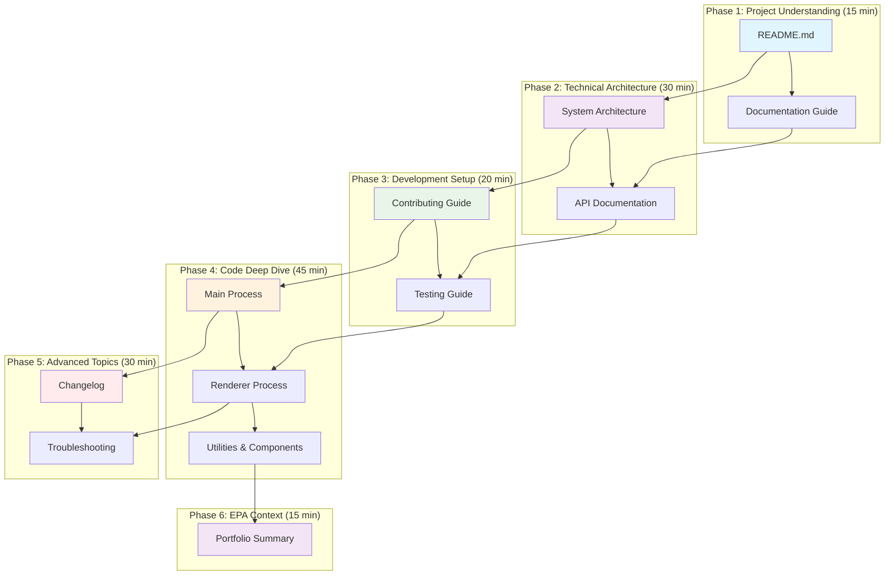

## Phase 1: Project Understanding (15 minutes)

### 1. README.md (Root)
**Why first:** Complete project overview and quick start

**What you'll learn:**
- What the project does and why
- How to install and run it
- Key features and capabilities
- Where to find everything

**Key sections to focus on:**
- Project description and purpose
- Installation instructions
- Quick start guide
- Project structure overview

### 2. docs/COMPLETE-DOCUMENTATION-GUIDE.md
**Why second:** Navigation map for all documentation

**What you'll learn:**
- Where every document is located
- What each document contains
- How documents relate to each other
- Best reading order

**Navigation Strategy:**
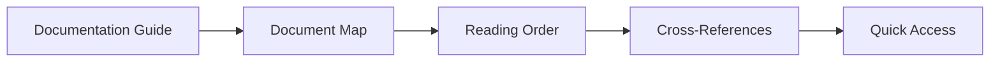

## Phase 2: Technical Architecture (30 minutes)

### 3. docs/SYSTEM-ARCHITECTURE.md
**Why third:** How the system is designed

**What you'll learn:**
- System architecture diagrams
- Data flow between processes
- Component relationships
- Technical design decisions

**Architecture Understanding:**
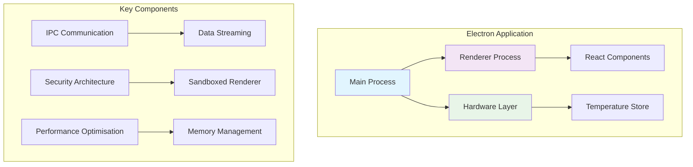

### 4. docs/API.md
**Why fourth:** How to work with the code

**What you'll learn:**
- IPC channels and communication
- Main process APIs
- Renderer components
- Data structures and usage examples

**API Architecture Flow:**
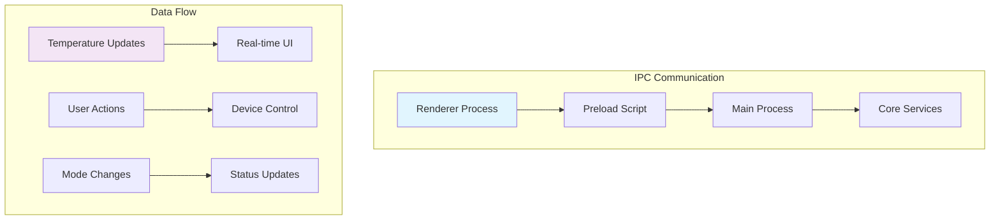

## Phase 3: Development Setup (20 minutes)

### 5. docs/CONTRIBUTING.md
**Why fifth:** How to develop safely

**What you'll learn:**
- Development environment setup
- Code style and conventions
- Testing requirements
- Git workflow and commit standards

**Development Workflow:**
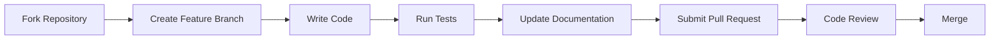

### 6. __tests__/README.md
**Why sixth:** How testing works

**What you'll learn:**
- Test structure and organisation
- How to run tests
- Test categories and purposes
- Coverage expectations

**Testing Architecture:**
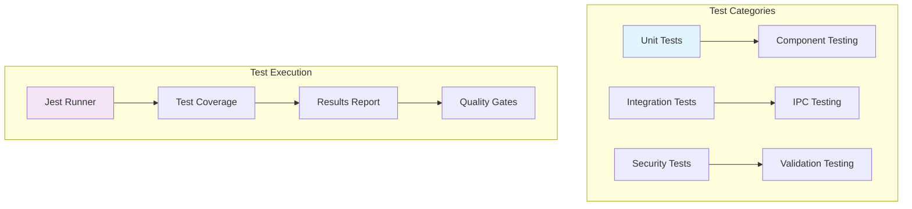

## Phase 4: Code Deep Dive (45 minutes)

### 7. Source Code Exploration

**Order to read:**

#### Core Application Flow
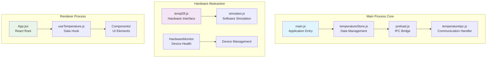

1. `src/main/main.js` - Application entry point
2. `src/main/state/temperatureStore.js` - Data management
3. `src/main/preload.js` - IPC bridge setup
4. `src/renderer/App.jsx` - React application root
5. `src/renderer/components/` - UI components
6. `src/renderer/hooks/` - Custom React hooks
7. `src/main/utils/consoleColours.js` - Cross-platform console utilities

### Console Utilities Deep Dive

The `consoleColours.js` module provides professional logging with specialised functions:

**Console Utility Architecture:**
```mermaid
graph TB
    subgraph "Console Functions"
        A[success] --> B[Green [OK] messages]
        C[error] --> D[Red [ERROR] messages]
        E[warning] --> F[Yellow [!] messages]
        G[info] --> H[Cyan [i] messages]
    end
    
    subgraph "Context Functions"
        I[hardware] --> J[Blue [+] [HAL] messages]
        K[simulator] --> L[Magenta [~] SIMULATOR messages]
        M[temperature] --> N[Source-aware colouring]
        O[status] --> P[Type-based formatting]
    end
    
    subgraph "Utility Functions"
        Q[separator] --> R[Visual organisation]
        S[header] --> T[Section formatting]
    end
    
    style A fill:#e1f5fe
    style I fill:#f3e5f5
    style Q fill:#e8f5e8
```

**Core Logging Functions:**
- `success(message)` - Green [OK] prefixed messages
- `error(message)` - Red [ERROR] prefixed messages  
- `warning(message)` - Yellow [!] prefixed messages
- `info(message)` - Cyan [i] prefixed messages

**Context-Specific Functions:**
- `hardware(message)` - Blue [+] [HAL] prefixed hardware messages
- `simulator(message)` - Magenta [~] SIMULATOR formatted messages
- `temperature(celsius, fahrenheit, source = 'REAL')` - Temperature logging with source-aware colouring
- `status(message, type = 'info')` - Configurable status messages with type-based colouring

**Utility Functions:**
- `separator()` - Visual separator lines for console organisation
- `header(title)` - Formatted section headers with uppercase conversion

**Exported Objects:**
- `colours` - ANSI colour code object (15 colour definitions)
- `symbols` - Symbol definitions object (7 symbol definitions)

**Key Features:**
- ANSI colour formatting for visual distinction
- ASCII-safe notation (deg C instead of °C symbol)
- Cross-platform terminal compatibility
- 50KB stable memory footprint
- Semantic logging with meaningful prefixes

**Usage Examples (seen in actual codebase):**
```javascript
// From main.js
consoleColours.header('AMF-Temperature-Plotter Starting');
consoleColours.info('Starting hardware monitoring...');
consoleColours.success('Hardware signal detected! Initiating switch...');
consoleColours.status('Performing hard DLL refresh to check for new device...', 'info');
consoleColours.warning('Hardware timeout detected. Injecting final 10.00 deg C reading.');

// From tempDll.js
consoleColours.hardware(`Session Start: Forcing 30.00 deg C (Sensor was: ${fTemp.toFixed(2)})`);
consoleColours.temperature(24.5, 76.1, 'REAL');
consoleColours.error('Hardware Start Error: ' + err.message);

// From simulator.js
consoleColours.temperature(22.0, 71.6, 'SIMULATOR');
consoleColours.simulator('Stopped: No final reading sent (Hardware disconnected - using simulation)');
```

## Phase 5: Advanced Topics (30 minutes)

### 8. docs/CHANGELOG.md
**Why eighth:** Project evolution and decisions

**What you'll learn:**
- Version history and changes
- Feature development timeline
- Bug fixes and improvements
- Technical debt and resolutions
- Recent evolution from static to dynamic reporting (v1.1.0)

**Project Evolution Timeline:**
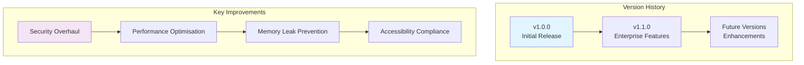

### 9. TROUBLESHOOTING.md
**Why ninth:** Common problems and solutions

**What you'll learn:**
- Known issues and fixes
- Debugging techniques
- Hardware integration problems
- Performance optimisation tips

**Troubleshooting Flow:**
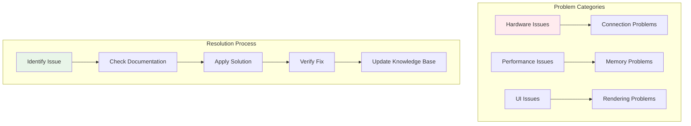

## Phase 6: EPA Context (Optional - 15 minutes)

### 10. EPA-PORTFOLIO-SUMMARY.md
**Why last:** Project purpose and assessment context

**What you'll learn:**
- Why the project was built
- What skills it demonstrates
- Assessment requirements met
- Business impact and value

**Assessment Context:**
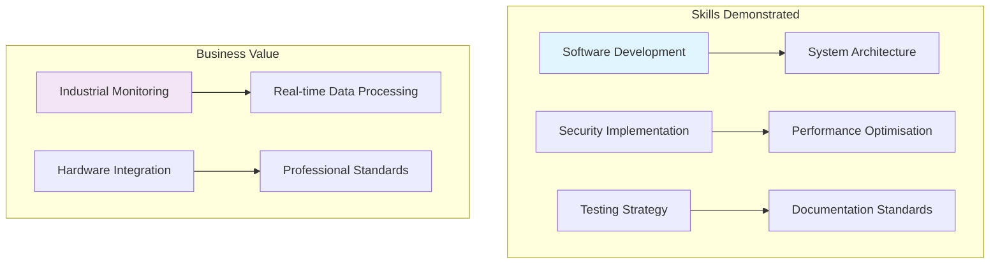

## Quick Reference - Developer Essentials

### For Immediate Work:
- **Running the app:** README.md → Installation section
- **Making changes:** docs/CONTRIBUTING.md → Development guidelines
- **Testing:** __tests__/README.md → Test commands
- **API usage:** docs/API.md → Function references

### For Understanding Architecture:
- **Big picture:** docs/SYSTEM-ARCHITECTURE.md → Diagrams
- **Data flow:** docs/API.md → IPC channels
- **Component structure:** Source code exploration

### For Problem Solving:
- **Common issues:** TROUBLESHOOTING.md
- **Test failures:** __tests__/README.md
- **Code style:** docs/CONTRIBUTING.md

## Development Environment Setup

### Prerequisites Installation Flow
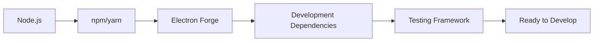

### First-Time Setup Commands
```bash
# Clone repository
git clone https://github.com/Interlaken0/temperature-plotter.git
cd temperature-plotter

# Install dependencies
npm install

# Run application
npm start

# Run tests
npm test
```

## Code Quality Standards

### British English Compliance
- Use British English spelling only (colour, behaviour, organised, etc.)
- Professional UK English terminology throughout
- No American English spellings in any files
- Consistent grammar and punctuation

### Code Style Requirements
- Follow existing code patterns
- Use semantic variable naming
- Maintain consistent indentation
- Add meaningful comments

### Security Standards
- Follow Electron security best practices
- Maintain context isolation
- Use secure IPC patterns
- Validate all inputs

## Total Time Investment: ~2.5 hours

This reading order takes a new developer from complete ignorance to productive contributor by building understanding progressively from high-level overview to deep technical details.

## Learning Path Summary

```mermaid
graph TB
    subgraph "Knowledge Building"
        A[Project Context] --> B[Technical Architecture]
        B --> C[Development Environment]
        C --> D[Code Implementation]
        D --> E[Advanced Topics]
        E --> F[Business Context]
    end
    
    subgraph "Skill Development"
        G[Reading Documentation] --> H[Understanding Code]
        H --> I[Running Tests]
        I --> J[Making Changes]
        J --> K[Contributing Features]
    end
    
    style A fill:#e1f5fe
    style G fill:#f3e5f5
```

## Additional Resources

- **Project Repository:** https://github.com/Interlaken0/temperature-plotter
- **Test Evidence:** evidence/test-reports/
- **Visual Documentation:** evidence/screenshots/
- **Performance Metrics:** evidence/PERFORMANCE-METRICS.md

## Getting Help

If you need clarification after completing this onboarding sequence:

1. **Check TROUBLESHOOTING.md** for common issues
2. **Review the test suite** for usage examples
3. **Examine the API documentation** for technical details
4. **Refer to the complete documentation guide** for additional resources

## Next Steps After Onboarding

1. **Explore the codebase** independently
2. **Run the test suite** to understand testing patterns
3. **Make a small contribution** to practice the workflow
4. **Review recent pull requests** to understand development patterns
5. **Join team discussions** to stay informed about project direction

## Success Indicators

You've successfully completed onboarding when you can:

- ✅ Explain the system architecture to another developer
- ✅ Run the application and all tests locally
- ✅ Make and test a simple code change
- ✅ Navigate the documentation efficiently
- ✅ Understand the project's business context
- ✅ Follow the contribution guidelines correctly

---

*This document is part of the Temperature Plotter project documentation suite. For a complete list of all available documentation, see docs/COMPLETE-DOCUMENTATION-GUIDE.md.*