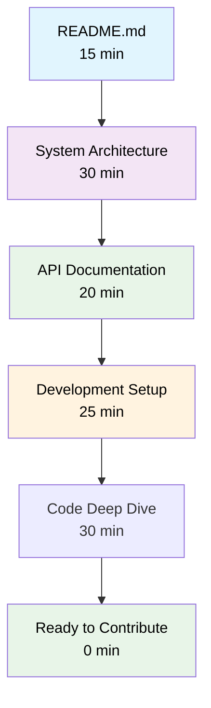

# New Developer Onboarding Guide

## Overview

Structured onboarding for new developers joining the Temperature Plotter project. This guide takes you from project newcomer to productive contributor in approximately 2 hours.

## Quick Start Path



## Phase 1: Project Understanding (15 minutes)

### 1. README.md
**Purpose:** Project overview and quick start

**Key sections:**
- Project description and features
- Installation instructions
- Quick start guide
- Project structure

### 2. docs/COMPLETE-DOCUMENTATION-GUIDE.md
**Purpose:** Documentation navigation map

**What you'll learn:**
- Where all documents are located
- Reading order and relationships
- Quick access to specific information

## Phase 2: Technical Architecture (30 minutes)

### 3. docs/SYSTEM-ARCHITECTURE.md
**Purpose:** System design overview

**Key concepts:**
- Electron process architecture (Main ↔ Renderer)
- Hardware abstraction layer
- Data flow and IPC communication
- Security boundaries and performance features

### 4. docs/API.md
**Purpose:** How to work with the code

**Key areas:**
- IPC channels for communication
- Main process APIs and utilities
- Renderer components and hooks
- Data structures and usage examples

## Phase 3: Development Setup (25 minutes)

### 5. __tests__/README.md
**Purpose:** Testing framework understanding

**Key points:**
- Test structure and organisation
- How to run tests and check coverage
- Test categories (unit, integration, security)
- Expected test results (142 tests passing across 12 test suites)

## Phase 4: Code Deep Dive (30 minutes)

### Core Files to Understand

**Main Process:**
1. `src/main/main.js` - Application entry point
2. `src/main/state/temperatureStore.js` - Data management with ring buffer
3. `src/main/preload.js` - Secure IPC bridge
4. `src/main/utils/consoleColours.js` - Professional logging utilities

**Renderer Process:**
5. `src/renderer/App.jsx` - React application root
6. `src/renderer/hooks/useTemperature.js` - Data streaming hook
7. `src/renderer/components/` - UI components (chart, status, controls)

**Hardware Layer:**
8. `src/main/dll/tempDll.js` - Hardware interface
9. `src/main/simulator.js` - Software simulation fallback

### Console Utilities Overview

The `consoleColours.js` module provides professional logging:

**Core Functions:**
- `success(message)` - Green [OK] messages
- `error(message)` - Red [ERROR] messages
- `warning(message)` - Yellow [!] messages
- `info(message)` - Cyan [i] messages

**Context Functions:**
- `hardware(message)` - Blue [+] [HAL] messages
- `simulator(message)` - Magenta [~] SIMULATOR messages
- `temperature(celsius, fahrenheit, source)` - Source-aware temperature logging
- `status(message, type)` - Type-dependent status messages

**Key Features:**
- ANSI colour formatting for visual distinction
- ASCII-safe notation (deg C instead of °C)
- Cross-platform terminal compatibility
- Professional semantic logging

## Development Environment Setup

### Prerequisites
```bash
# Check Node.js version (16+ required)
node --version

# Clone repository
git clone https://github.com/Interlaken0/temperature-plotter.git
cd temperature-plotter

# Install dependencies
npm install

# Run application
npm start

# Run tests
npm test
```

### Code Quality Standards

**British English Compliance:**
- Use British spelling only (colour, behaviour, organised, etc.)
- Professional UK English terminology
- No American English spellings

**Security Standards:**
- Follow Electron security best practices
- Maintain context isolation and sandboxing
- Use secure IPC patterns
- Validate all inputs (-50°C to 200°C range)

**Testing Standards:**
- Maintain 142-test baseline across 12 test suites
- 100% test coverage expected
- Include unit, integration, and security tests

## Quick Reference

### For Immediate Work:
- **Run app:** `npm start`
- **Test:** `npm test`
- **Build:** `npm run make`
- **Package:** `npm run package`

### For Understanding:
- **Architecture:** docs/SYSTEM-ARCHITECTURE.md
- **API reference:** docs/API.md
- **Troubleshooting:** docs/TROUBLESHOOTING.md

### For Problem Solving:
- **Common issues:** Check TROUBLESHOOTING.md first
- **Test failures:** Review __tests__/README.md
- **Hardware issues:** Check DLL paths and permissions
- **Console issues:** Verify consoleColours.js usage

## Success Indicators

You're ready to contribute when you can:

- ✅ Run the application and all tests locally
- ✅ Explain the basic system architecture
- ✅ Navigate the documentation efficiently
- ✅ Make and test a simple code change
- ✅ Understand the project's purpose

## Next Steps

1. **Explore the codebase** independently
2. **Make a small contribution** to practice the workflow
3. **Review recent pull requests** for development patterns
4. **Join team discussions** for project direction
5. **Check EPA portfolio context** for assessment requirements

## Additional Resources

- **Repository:** https://github.com/Interlaken0/temperature-plotter
- **Documentation guide:** docs/COMPLETE-DOCUMENTATION-GUIDE.md
- **Test evidence:** evidence/test-reports/
- **Performance metrics:** evidence/PERFORMANCE-METRICS.md

---

*Simplified onboarding guide for AMF Temperature Plotter - approximately 2 hours to productive contributor*