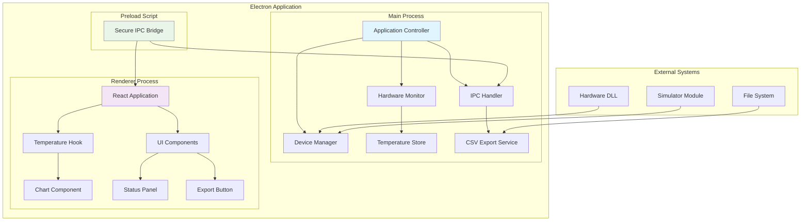
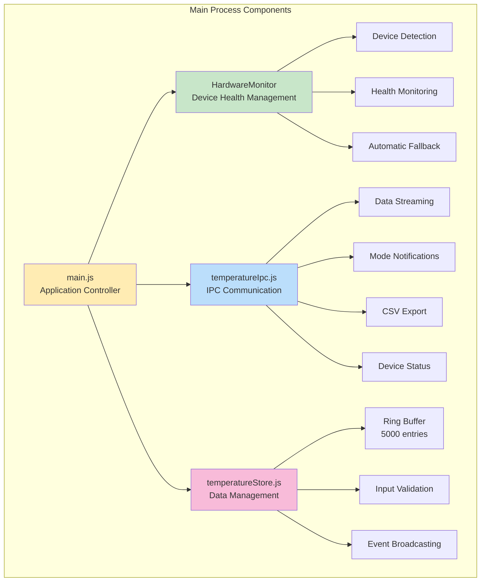
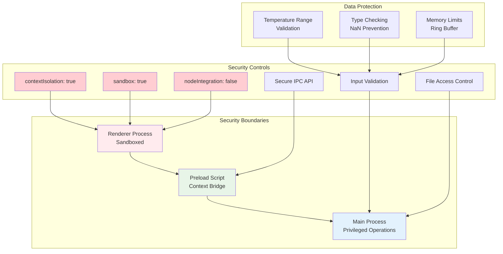
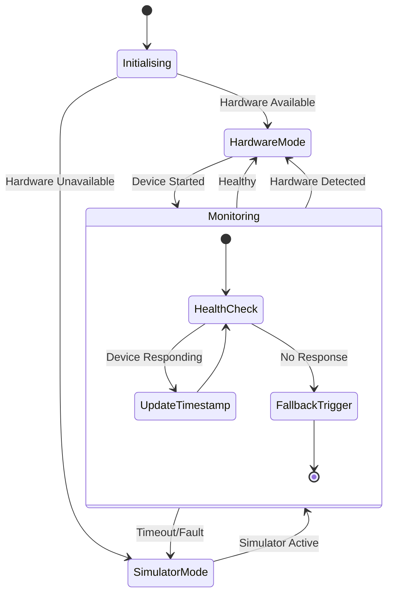
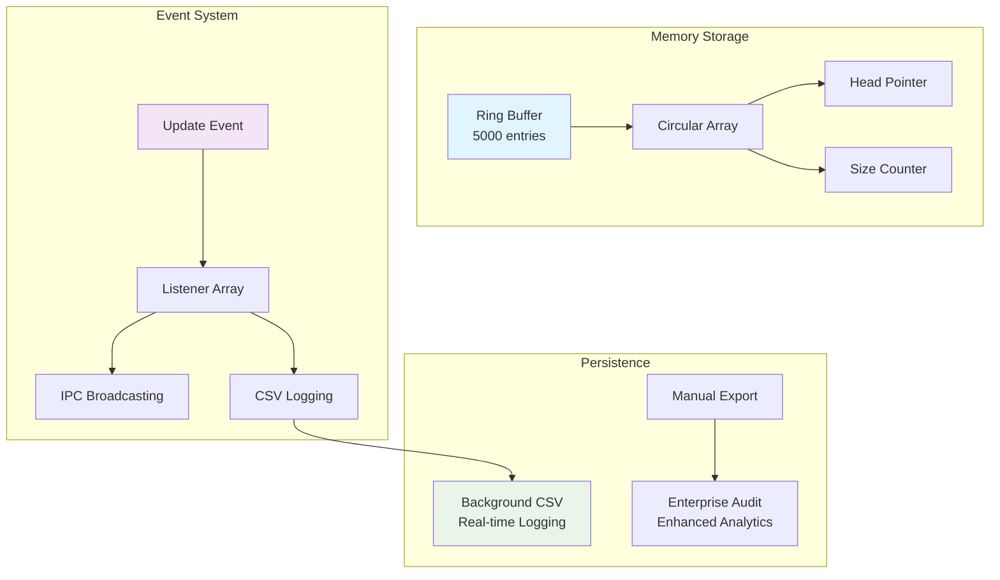
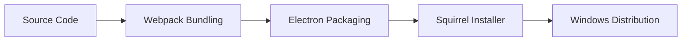

# System Architecture - AMF Temperature Plotter

## Overview

The AMF Temperature Plotter is an enterprise-grade temperature monitoring application built with Electron, React, and Node.js. The system provides real-time temperature data visualisation with automatic hardware/simulator switching, comprehensive data logging, and professional user interface design.

## Architecture Principles

- **Security First**: Context isolation, sandboxed renderer, secure IPC communication
- **High Availability**: Automatic fallback between hardware and simulation modes
- **Memory Efficient**: Ring buffer implementation with controlled memory usage
- **Real-time Performance**: Optimised data streaming and UI updates
- **Professional Standards**: British English compliance, comprehensive testing, enterprise logging

## High-Level Architecture



## Component Architecture

### 1. Main Process Architecture



### 2. Data Flow Architecture


### 3. Security Architecture



## Module Architecture

### 1. Core Modules

#### Main Process Modules
- **main.js**: Application lifecycle, window management, device coordination
- **HardwareMonitor**: Device health monitoring, automatic fallback logic
- **temperatureIpc.js**: IPC communication handlers, CSV export service
- **temperatureStore.js**: Ring buffer data management, event broadcasting
- **consoleColours.js**: Professional logging utilities

#### Renderer Process Modules
- **App.jsx**: Root component, state management, layout coordination
- **useTemperature.js**: Custom hook for data streaming and management
- **Components**: UI components for charting, status, and user interaction

#### Shared Resources
- **preload.js**: Secure IPC bridge between processes
- **constants.js**: Shared application constants

### 2. Device Management Architecture



## Data Architecture

### 1. Temperature Data Structure

```typescript
interface TemperatureReading {
    time: number;           // Unix timestamp
    temp: number;           // Temperature in Celsius
    isHardwareMode: boolean; // Data source indicator
}

interface TemperatureData {
    temp: number;           // Current temperature
    history: TemperatureReading[]; // Historical data array
}
```

### 2. Storage Architecture



## Communication Architecture

### 1. IPC Channel Architecture


### 2. Component Communication


## Technology Stack

### Core Technologies
- **Electron v40.1.0**: Desktop application framework
- **React v18.2.0**: User interface library
- **Node.js**: Backend runtime environment
- **Webpack v5.91.0**: Module bundler

### Supporting Libraries
- **Recharts v2.12.0**: Data visualisation
- **Koffi v2.15.1**: Foreign Function Interface for hardware DLL
- **TailwindCSS v3.4.17**: Utility-first CSS framework
- **Jest v29.7.0**: Testing framework

### Development Tools
- **Electron Forge v7.3.0**: Application packaging
- **Babel**: JavaScript transpilation
- **PostCSS**: CSS processing

## Performance Considerations

### 1. Memory Management
- Ring buffer limits memory usage to 5000 entries
- Automatic cleanup of event listeners
- Lazy loading of hardware DLL

### 2. Real-time Performance
- Optimised IPC communication
- Efficient React rendering with hooks
- Debounced UI updates

### 3. Resource Optimisation
- Background CSV logging without blocking UI
- Hardware health monitoring with configurable intervals
- Automatic fallback prevents application crashes

## Security Architecture

### 1. Process Isolation
- Renderer process sandboxing
- Context isolation enabled
- Node integration disabled

### 2. Data Validation
- Temperature range validation (-50°C to 200°C)
- Type checking and NaN prevention
- Input sanitisation for all data sources

### 3. File System Security
- Controlled file access through main process
- Secure CSV export with user confirmation
- Path validation for file operations

## Testing Architecture

### 1. Test Coverage
- 99 comprehensive tests covering all modules
- Unit tests for core functionality
- Integration tests for IPC communication
- UI component testing with React Testing Library

### 2. Test Categories
- **Unit Tests**: Individual function testing
- **Integration Tests**: Module interaction testing
- **Security Tests**: Input validation and boundary testing
- **Performance Tests**: Memory and timing validation

## Deployment Architecture

### 1. Build Process


### 2. Distribution
- Squirrel-based Windows installer
- Automatic update capability
- Version management and rollback

## Maintenance and Monitoring

### 1. Logging System
- Professional console output with colour coding
- Background CSV logging for audit trails
- Error tracking and reporting

### 2. Health Monitoring
- Hardware connection monitoring
- Application performance tracking
- Memory usage optimisation

### 3. Error Handling
- Graceful degradation on hardware failure
- Comprehensive error logging
- User-friendly error messages

## Future Scalability

### 1. Extensible Architecture
- Plugin-based device support
- Configurable data sources
- Modular component design

### 2. Data Expansion
- Multiple sensor support
- Enhanced analytics capabilities
- Cloud integration readiness

### 3. UI Enhancements
- Responsive design improvements
- Accessibility compliance
- Internationalisation support

---

*This architecture document reflects the current implementation of the AMF Temperature Plotter as of version 1.1.0, following British English standards and enterprise development practices.*
