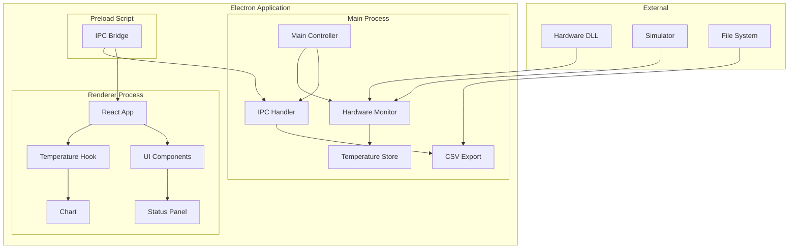
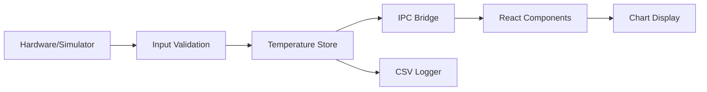
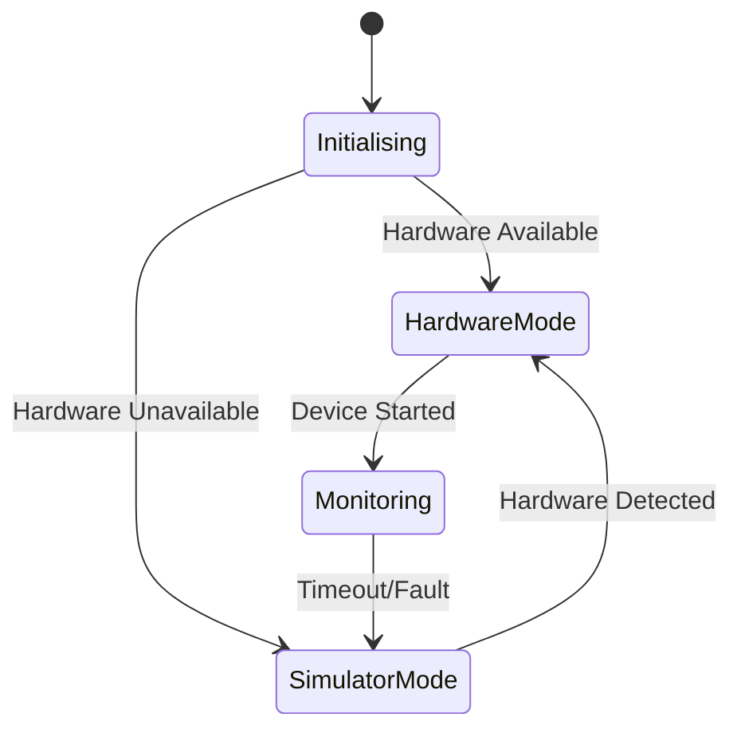

# System Architecture - AMF Temperature Plotter

## Overview

Temperature monitoring application built with Electron, React, and Node.js featuring real-time data visualisation with automatic hardware/simulator switching.

## High-Level Architecture

## Core Components

### Main Process
- **main.js**: Application lifecycle and device coordination
- **ipc/temperatureIpc.js**: IPC communication and CSV export
- **state/temperatureStore.js**: Ring buffer data management (5000 entries)
- **utils/consoleColours.js**: Professional logging utilities

### Renderer Process
- **App.jsx**: Root component and state management
- **hooks/useTemperature.js**: Data streaming hook with dual buffer management
- **components/**: Chart, status panel, and UI controls

### Shared
- **preload.js**: Secure IPC bridge
- **shared/constants.js**: Application constants

## Data Flow

## Device Management

## Technology Stack

- **Electron v40.1.0**: Desktop framework
- **React v18.2.0**: UI library
- **Node.js**: Backend runtime
- **Recharts v2.12.0**: Data visualisation
- **TailwindCSS v3.4.17**: Styling
- **Jest v29.7.0**: Testing

## Key Features

- **Automatic Fallback**: Hardware ↔ Simulator switching
- **Memory Efficient**: Ring buffer with 5000 entry limit
- **Real-time Updates**: Optimised IPC communication
- **Secure Architecture**: Sandboxed renderer, context isolation
- **Professional Logging**: Colour-coded console output with ASCII-safe notation
- **Data Export**: CSV export with enterprise audit trail

## Console Utilities Architecture

The consoleColours.js module provides professional logging with specialised functions:

### Core Logging Functions
- `success(message)` - Green [OK] prefixed messages
- `error(message)` - Red [ERROR] prefixed messages  
- `warning(message)` - Yellow [!] prefixed messages
- `info(message)` - Cyan [i] prefixed messages

### Context-Specific Functions
- `hardware(message)` - Blue [+] [HAL] prefixed hardware messages
- `simulator(message)` - Magenta [~] SIMULATOR formatted messages
- `temperature(celsius, fahrenheit, source = 'REAL')` - Source-aware temperature logging with dynamic colouring
- `status(message, type = 'info')` - Type-dependent status messages with blue default

### Utility Functions
- `separator()` - Visual separator lines (50 equal signs with dim formatting)
- `header(title)` - Formatted section headers with cyan formatting and uppercase conversion

### Exported Objects
- `colours` - 15 ANSI colour codes (reset, bright, dim, red, green, yellow, blue, magenta, cyan, white, gray, bgRed, bgGreen, bgYellow, bgBlue)
- `symbols` - 7 symbol definitions (success, error, warning, info, hardware, simulator, temperature)

## Security

- Renderer process sandboxing
- Context isolation enabled
- Node integration disabled
- Input validation (-50°C to 200°C range)
- Secure file access controls

## Performance

- Ring buffer prevents memory leaks (5000 entry limit)
- Optimised React rendering with memory leak prevention
- Background CSV logging with enhanced telemetry
- Debounced UI updates and dual buffer management

---

*Simplified architecture overview for the AMF Temperature Plotter*
