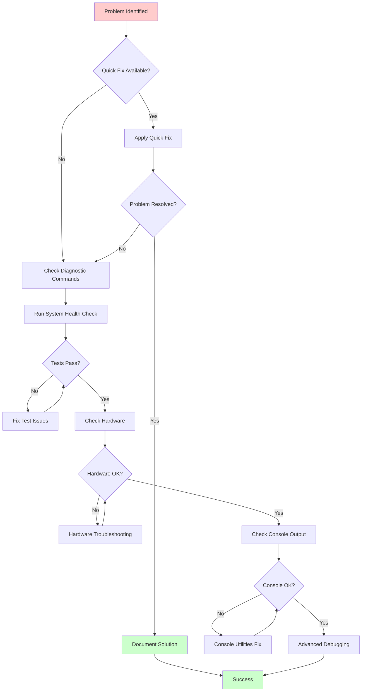
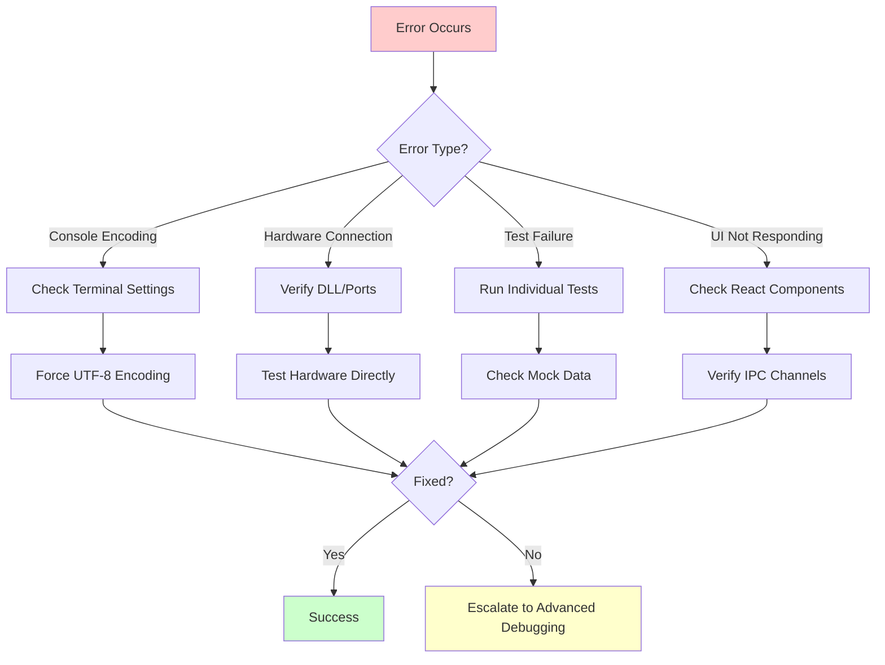

# Troubleshooting Guide
## Common Issues and Solutions for Temperature Plotter

This guide provides solutions to common problems developers and users may encounter while setting up, developing, or running the Temperature Plotter application.

## Table of Contents

- [Installation Issues](#installation-issues)
- [Development Setup Problems](#development-setup-problems)
- [Application Runtime Issues](#application-runtime-issues)
- [Testing Problems](#testing-problems)
- [Build and Package Issues](#build-and-package-issues)
- [Performance Issues](#performance-issues)
- [Hardware Integration Issues](#hardware-integration-issues)
- [Platform-Specific Issues](#platform-specific-issues)
- [Version 1.1.0 Specific Issues](#version-110-specific-issues)
- [Quick-Fix Solutions](#quick-fix-solutions)
- [Diagnostic Commands](#diagnostic-commands)

## Installation Issues

### Issue: "npm install fails with permission errors"
**Symptoms:**
```
npm ERR! code EACCES
npm ERR! syscall open
npm ERR! path /path/to/file
```

**Solutions:**
1. **Run as Administrator (Windows):**
   ```bash
   # Right-click Command Prompt/PowerShell and "Run as administrator"
   npm install
   ```

2. **Change npm permissions:**
   ```bash
   npm config set prefix ~/.npm-global
   export PATH=~/.npm-global/bin:$PATH
   npm install
   ```

3. **Use npx (temporary):**
   ```bash
   npx npm install
   ```

### Issue: "Node.js version incompatible"
**Symptoms:**
```
npm ERR! engine Unsupported engine
npm ERR! engine Not compatible with your version of Node.js
```

**Solutions:**
1. **Check Node.js version:**
   ```bash
   node --version  # Should be 16+
   ```

2. **Update Node.js (Windows):**
   - Download latest LTS from [nodejs.org](https://nodejs.org/)
   - Or use Chocolatey: `choco install nodejs-lts`

3. **Use Node Version Manager (nvm):**
   ```bash
   nvm install 18
   nvm use 18
   npm install
   ```

### Issue: "Python not found error during build"
**Symptoms:**
```
gyp: Call to 'python' returned exit code 1
```

**Solutions:**
1. **Install Python 3.x:**
   ```bash
   # Windows
   # Download from python.org or use chocolatey
   choco install python
   
   # Set npm config
   npm config set python python3
   ```

2. **Use Windows Build Tools:**
   ```bash
   npm install --global --production windows-build-tools
   ```

## Development Setup Problems

### Issue: "npm start fails to start"
**Symptoms:**
```
ERROR: The main process entry point is missing
```

**Solutions:**
1. **Check webpack configuration:**
   ```bash
   # Verify webpack config exists
   ls config/
   cat config/webpack.main.config.js
   ```

2. **Rebuild webpack:**
   ```bash
   rm -rf .webpack/
   npm start
   ```

3. **Check Electron installation:**
   ```bash
   npm ls electron
   npm install electron --save-dev
   ```

### Issue: "Hot reload not working"
**Symptoms:**
- Changes to React components don't update the UI
- Need to restart application to see changes

**Solutions:**
1. **Check webpack dev server:**
   ```bash
   # Kill existing processes
   taskkill /f /im electron.exe
   npm start
   ```

2. **Verify file watching:**
   ```bash
   # Check if files are being watched
   npm start -- --verbose
   ```

3. **Clear webpack cache:**
   ```bash
   rm -rf .webpack/cache/
   npm start
   ```

### Issue: "Port already in use"
**Symptoms:**
```
Error: listen EADDRINUSE: address already in use :::3000
```

**Solutions:**
1. **Find and kill process:**
   ```bash
   # Windows
   netstat -ano | findstr :3000
   taskkill /PID <PID> /f
   
   # Or use different port
   npm start -- --port 3001
   ```

## Application Runtime Issues

### Issue: "Application window doesn't open"
**Symptoms:**
- `npm start` starts but no window appears
- Process running in background but no UI

**Solutions:**
1. **Check main process logs:**
   ```bash
   npm start 2>&1 | tee main.log
   # Look for errors in main.log
   ```

2. **Verify renderer path:**
   ```bash
   # Check if index.html exists
   ls src/renderer/
   cat src/renderer/index.html
   ```

3. **Check preload script:**
   ```bash
   # Verify preload.js exists and is correct
   cat src/main/preload.js
   ```

### Issue: "Temperature data not updating"
**Symptoms:**
- Chart shows static data
- No new temperature readings

**Solutions:**
1. **Check simulator:**
   ```bash
   # Test simulator directly
   node -e "require('./src/main/simulator.js').start()"
   ```

2. **Verify IPC communication:**
   ```bash
   # Check browser console for IPC errors
   # Open DevTools in running app (Ctrl+Shift+I)
   ```

3. **Check temperature store:**
   ```bash
   # Test temperature store
   node -e "
   const store = require('./src/main/state/temperatureStore.js');
   console.log('Store status:', store.getStatus());
   "
   ```

### Issue: "CSV export not working"
**Symptoms:**
- Click export button but nothing happens
- File download fails

**Solutions:**
1. **Check IPC handler:**
   ```bash
   # Look for export-csv handler in main.js
   grep -n "export-csv" src/main/main.js
   ```

2. **Verify file system permissions:**
   ```bash
   # Test file write permissions
   echo "test" > test.csv
   rm test.csv
   ```

3. **Check data availability:**
   ```bash
   # Verify temperature data exists
   cat temperature_telemetry.csv
   ```

## Testing Problems

### Issue: "Tests fail with 'module not found' errors"
**Symptoms:**
```
Cannot find module 'src/main/simulator.js' from 'simulator.test.js'
```

**Solutions:**
1. **Check Jest configuration:**
   ```bash
   # Verify jest config in package.json
   cat package.json | grep -A 10 '"jest"'
   ```

2. **Update module paths:**
   ```bash
   # Use absolute paths in tests
   # Change: require('../main/simulator.js')
   # To: require('../../src/main/simulator.js')
   ```

3. **Check file structure:**
   ```bash
   # Verify test file locations
   find __tests__ -name "*.test.js"
   ```

### Issue: "Coverage report not generating"
**Symptoms:**
- Tests pass but no coverage report
- Coverage shows 0%

**Solutions:**
1. **Generate coverage manually:**
   ```bash
   npm test -- --coverage --coverageReporters=html
   ```

2. **Check coverage directory:**
   ```bash
   ls -la coverage/
   # Open coverage/lcov-report/index.html
   ```

3. **Update Jest config:**
   ```json
   "jest": {
     "collectCoverage": true,
     "coverageDirectory": "coverage",
     "coverageReporters": ["html", "text", "lcov"]
   }
   ```

### Issue: "Mock functions not working"
**Symptoms:**
- Mocked functions still call original implementation
- Test timeouts or unexpected behaviour

**Solutions:**
1. **Clear mocks between tests:**
   ```javascript
   afterEach(() => {
     jest.clearAllMocks();
   });
   ```

2. **Verify mock implementation:**
   ```javascript
   const mockFunction = jest.fn();
   mockFunction.mockReturnValue('test value');
   ```

## Build and Package Issues

### Issue: "npm run make fails"
**Symptoms:**
```
Module not found: Error: Can't resolve 'react'
```

**Solutions:**
1. **Clean and reinstall:**
   ```bash
   rm -rf node_modules/ package-lock.json
   npm install
   npm run make
   ```

2. **Check webpack configuration:**
   ```bash
   # Verify webpack config paths
   cat config/webpack.renderer.config.js
   ```

3. **Update dependencies:**
   ```bash
   npm update
   npm run make
   ```

### Issue: "npm run package fails"
**Symptoms:**
```
ERROR: Failed to package application
```

**Solutions:**
1. **Check Electron Forge configuration:**
   ```bash
   cat forge.config.js
   ```

2. **Verify output directory:**
   ```bash
   rm -rf out/
   npm run package
   ```

3. **Check system resources:**
   ```bash
   # Ensure enough disk space and memory
   dir
   tasklist | findstr node
   ```

## Performance Issues

### Issue: "High memory usage"
**Symptoms:**
- Application uses increasing memory over time
- System becomes slow after extended use

**Solutions:**
1. **Check for memory leaks:**
   ```bash
   # Monitor Node.js process
   tasklist /fi "imagename eq electron.exe" /fo table
   ```

2. **Clean up intervals:**
   ```javascript
   // Ensure all intervals are cleared
   useEffect(() => {
     const interval = setInterval(updateData, 1000);
     return () => clearInterval(interval);
   }, []);
   ```

3. **Optimise data storage:**
   ```javascript
   // Check ring buffer implementation
   // Ensure old data is properly removed
   ```

### Issue: "UI lag during updates"
**Symptoms:**
- Chart updates cause UI freezing
- Slow response to user interactions

**Solutions:**
1. **Optimise React rendering:**
   ```javascript
   // Use React.memo for expensive components
   const TemperatureChart = React.memo(({ data }) => {
     // Component implementation
   });
   ```

2. **Debounce updates:**
   ```javascript
   // Use useCallback for expensive operations
   const updateChart = useCallback(
     debounce((data) => {
       // Update chart logic
     }, 100),
     []
   );
   ```

3. **Reduce update frequency:**
   ```javascript
   // Consider updating chart less frequently
   // than data collection (e.g., every 500ms instead of 1000ms)
   ```

## Hardware Integration Issues

### Issue: "DLL not loading"
**Symptoms:**
```
Error: Dynamic Link Library "TempMeasure64.dll" not found
```

**Solutions:**
1. **Check DLL location:**
   ```bash
   # Verify DLL exists in expected location
   ls src/main/dll/
   ```

2. **Update DLL path:**
   ```javascript
   // Check tempDll.js for correct path
   const dllPath = path.join(__dirname, 'dll', 'TempMeasure64.dll');
   ```

3. **Check DLL dependencies:**
   ```bash
   # Use Dependency Walker to check DLL dependencies
   # Or: dumpbin /dependents TempMeasure64.dll
   ```

### Issue: "Hardware not detected"
**Symptoms:**
- Application shows "Disconnected" status
- No temperature data from hardware

**Solutions:**
1. **Check hardware connection:**
   ```bash
   # Verify device manager shows connected hardware
   # Check COM ports in Windows
   ```

2. **Test DLL directly:**
   ```javascript
   // Create simple test to verify DLL functionality
   const dll = require('./src/main/dll/tempDll.js');
   console.log('DLL test:', dll.testConnection());
   ```

3. **Check permissions:**
   ```bash
   # Run as administrator if hardware access requires elevated permissions
   ```

## Platform-Specific Issues

### Windows-Specific Issues

#### Issue: "Windows Defender blocks application"
**Solutions:**
1. **Add exception to Windows Defender:**
   - Go to Windows Security → Virus & threat protection
   - Add exclusion for project directory
   - Add exclusion for built executable

2. **Code signing (for distribution):**
   ```bash
   # Configure code signing in forge.config.js
   ```

#### Issue: "Corrupted characters (┬░) appearing in the terminal"
**Symptoms:**
- Degree symbols (°) appear as ┬░ or other garbled text in Windows PowerShell or CMD

**Solutions:**
1. **Use ASCII-Safe Notation:**
   Ensure you are using the consoleColours.js utility which converts these to the string "deg C".

2. **Force UTF-8 Encoding:**
   If you must use the symbol, run this command in your terminal before starting the app:
   ```powershell
   [Console]::OutputEncoding = [System.Text.Encoding]::UTF8
   ```

3. **Check Terminal Fonts:**
   Ensure the terminal font (like Cascadia Code or Consolas) supports extended Unicode characters.

#### Issue: "Path separators in code"
**Symptoms:**
- File operations fail on Windows
- Path-related errors

**Solutions:**
1. **Use path module:**
   ```javascript
   const path = require('path');
   const filePath = path.join(__dirname, 'data', 'file.csv');
   ```

2. **Avoid hardcoded paths:**
   ```javascript
   // Bad: 'src\\main\\simulator.js'
   // Good: path.join(__dirname, 'simulator.js')
   ```

### macOS/Linux Issues (if applicable)

#### Issue: "Permission denied on file operations"
**Solutions:**
1. **Check file permissions:**
   ```bash
   chmod +x setup.sh
   ls -la temperature_telemetry.csv
   ```

2. **Use appropriate file paths:**
   ```javascript
   // Use user's home directory for writable files
   const os = require('os');
   const path = require('path');
   const userDataPath = path.join(os.homedir(), '.temperature-plotter');
   ```

## Version 1.1.0 Specific Issues

### Issue: "Fahrenheit display problems"
**Symptoms:**
- Fahrenheit values showing as undefined or NaN
- Incorrect temperature conversions
- Missing Fahrenheit values in CSV exports

**Solutions:**
1. **Check temperature conversion function:**
   ```javascript
   // Verify conversion in consoleColours.js
   const fahrenheit = (celsius * 9/5) + 32;
   ```

2. **Validate data structure:**
   ```javascript
   // Ensure temperature objects include fahrenheit field
   { timestamp: 123, value: 24.5, fahrenheit: 76.1, source: "REAL" }
   ```

3. **Check export formatting:**
   ```javascript
   // Verify CSV export includes Fahrenheit column
   const headers = ['timestamp', 'celsius', 'fahrenheit', 'source'];
   ```

### Issue: "Hardware mode switching not working"
**Symptoms:**
- Manual hardware override (force-hardware-mode) fails
- Mode change notifications not appearing in UI
- Application stuck in simulator mode

**Solutions:**
1. **Test manual override:**
   ```javascript
   // Check browser console for errors
   window.api.invoke('force-hardware-mode')
     .then(result => console.log('Hardware override:', result));
   ```

2. **Verify IPC channel setup:**
   ```javascript
   // Ensure mode:change listener is registered in main.js
   ipcMain.on('mode:change', (event, data) => {
     // Handle mode change notification
   });
   ```

3. **Check hardware timeout settings:**
   ```javascript
   // Verify timeout configuration in tempDll.js
   const HARDWARE_TIMEOUT = 5000; // 5 seconds
   ```

### Issue: "Console output missing colours"
**Symptoms:**
- Terminal output appears in plain text
- No colour-coded logging for temperature values
- Debug information hard to read

**Solutions:**
1. **Verify consoleColours.js import:**
   ```javascript
   // Check main.js imports console utilities
   const { logTemperature, logStatus } = require('./utils/consoleColours');
   ```

2. **Check terminal compatibility:**
   ```bash
   # Test if terminal supports ANSI colours
   echo -e "\033[31mRed Text\033[0m"
   ```

3. **Force colour output:**
   ```javascript
   // Set environment variable for colour output
   process.env.FORCE_COLOR = '1';
   ```

### Issue: "Test coverage regression"
**Symptoms:**
- Test count drops below 99 tests
- Coverage percentage falls below 100%
- Test summary generation fails

**Solutions:**
1. **Run full test suite:**
   ```bash
   npm test -- --coverage --verbose
   ```

2. **Check for missing tests:**
   ```bash
   # Verify test count matches expected
   npm test | grep -E "(passing|failing)"
   ```

3. **Regenerate test summary:**
   ```bash
   # Run test summary generation script
   node scripts/generate-test-summary.js
   ```

## Quick-Fix Solutions

| Problem | Quick Fix | Time |
|---------|-----------|------|
| App won't start | `npm install && npm start` | 2 mins |
| No temperature data | Check hardware connection | 1 min |
| Console garbled text | Use ASCII-safe notation | 30 secs |
| Tests failing | `npm test -- --updateSnapshot` | 1 min |
| Export not working | Check file permissions | 1 min |
| UI not updating | Restart application | 30 secs |

### Troubleshooting Flow Diagram



### Error Resolution Decision Tree



## Diagnostic Commands

### System Health Check
```bash
# Complete system diagnostic
npm run diagnose || npm test && npm run make && echo "System OK"
```

### Test Coverage Verification
```bash
# Verify 99-test baseline
npm test -- --coverage --passWithNoTests
node scripts/generate-test-summary.js
```

### Hardware Connection Test
```bash
# Test DLL integration
node -e "require('./src/main/dll/tempDll.js').testConnection()"
```

### Console Utilities Test
```bash
# Test colour output
node -e "require('./src/utils/consoleColours.js').testColours()"
```

## Getting Additional Help

### Debug Mode
Enable debug logging for troubleshooting:
```bash
# Set environment variable
set DEBUG=temperature-plotter:*
npm start
```

### Log Files
Check application logs:
```bash
# Main process logs
tail -f logs/main.log

# Renderer logs (check DevTools Console)
# Open app, press Ctrl+Shift+I, go to Console tab
```

### Community Support
1. **Check existing issues:** Search GitHub issues for similar problems
2. **Create detailed issue:** Include error messages, system info, and steps to reproduce
3. **Include diagnostics:** Run diagnostics script and include output

### Cross-Reference Documentation
For detailed technical information, see:
- **API Documentation:** [API.md](docs/API.md) - IPC channels and data structures
- **System Architecture:** [SYSTEM-ARCHITECTURE.md](docs/SYSTEM-ARCHITECTURE.md) - Design patterns and components
- **Development Guide:** [CONTRIBUTING.md](docs/CONTRIBUTING.md) - Development setup and standards

### Diagnostic Information
Create diagnostic report:
```bash
# System information
node --version
npm --version
electron --version

# Project information
npm ls
git status
git log --oneline -5
```

---

**Last Updated:** 2026-02-26  
**Version:** 1.1.0  
**For:** Temperature Plotter Application

If your issue isn't covered here, please create an issue in the project repository with detailed information about the problem you're experiencing.
