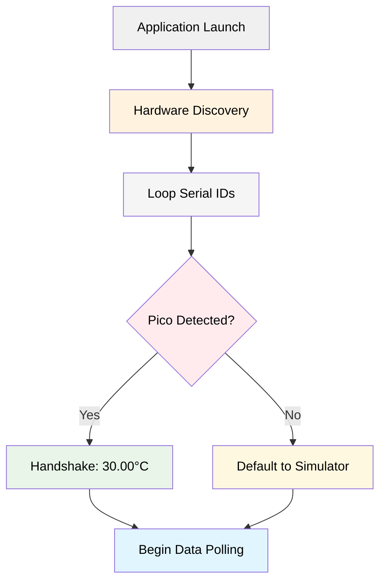
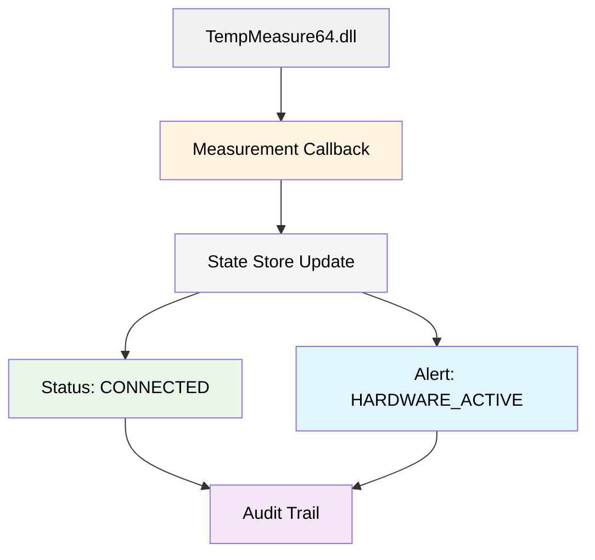
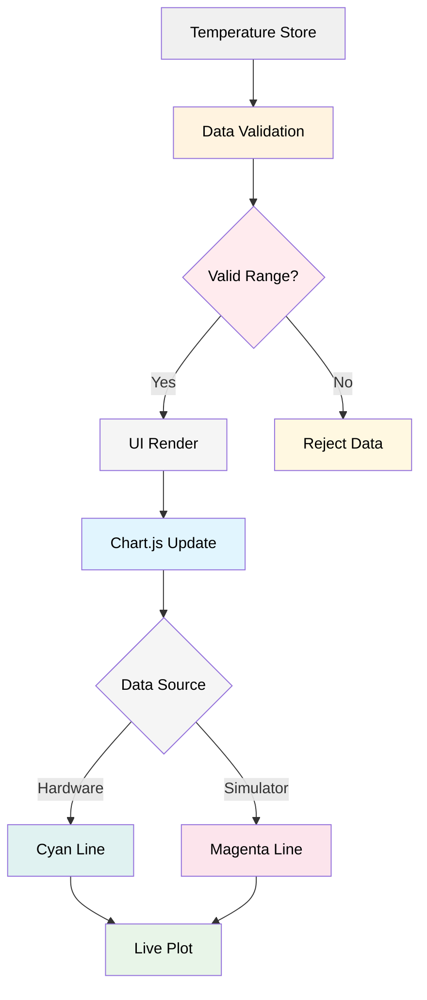
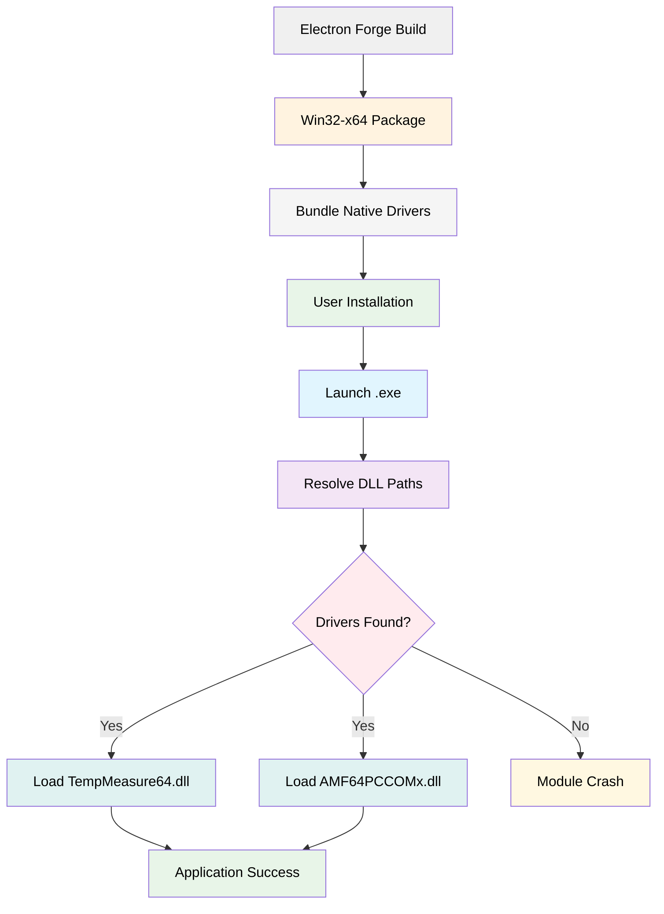

# User Stories - AMF Temperature Plotter

This document contains the user stories that define the functional requirements for the AMF Temperature Plotter application. Each story follows the standard format: "As a [user role], I want [functionality], so that [benefit]."

---

## Story 1: The Hardware Discovery Story

**Title:** Seamless Hardware Integration and Discovery

**As an** industrial machine operator,
**I want** the application to automatically detect and connect to authorised Raspberry Pi Pico devices upon launch,
**So that** I can begin monitoring physical temperatures immediately without needing to manually configure COM ports or connection strings.

### Acceptance Criteria

**Given** the application is launched and an authorised Pico is connected via USB.

**When** the hardware initialization script runs.

**Then** the system loops through known serial IDs, establishes a handshake (forcing an initial 30.00°C reading), and begins polling data.

**And** if no hardware is found, the system gracefully defaults to the software simulator without crashing.

### Story Flow Diagram

### Implementation Notes

- Hardware discovery is handled by the `hardware.js` module
- Serial ID enumeration uses the `AMF64PCCOMx.dll` driver
- Handshake protocol forces 30.00°C initial reading to verify connection
- Graceful fallback to simulator ensures application reliability
- No manual COM port configuration required by end users

---

## Story 2: The Telemetry Validation Story

**Title:** Audit-Ready Telemetry Labelling

**As a** quality assurance auditor (or Jeff),
**I want** the system telemetry to explicitly tag incoming data with accurate hardware states,
**So that** I can definitively differentiate between simulated data and physical hardware readings in the output logs.

### Acceptance Criteria

**Given** the application is actively receiving data from the TempMeasure64.dll.

**When** the measurement callback is triggered and passed to the state store.

**Then** the status label must be updated to "CONNECTED".

**And** the alert level label must be updated to "HARDWARE_ACTIVE".

### Story Flow Diagram

### Implementation Notes

- Telemetry tagging occurs in the `temperatureStore.js` module
- Status labels provide clear indication of data source
- Hardware state tracking enables audit trail verification
- All data points are labelled with source attribution
- Console utilities provide formatted logging for audit purposes

---

## Story 3: The Real-Time Visualisation Story

**Title:** Live Thermal Data Plotting

**As a** system monitor,
**I want** to see a live, updating graphical plot of the temperature data,
**So that** I can visually identify thermal trends, spikes, or drops over time without having to decipher raw numerical arrays.

### Acceptance Criteria

**Given** the temperature store is receiving valid data points (between -50°C and 200°C).

**When** the main window renders the UI.

**Then** a line graph updates dynamically at a set interval.

**And** the visual styling clearly indicates the data source (e.g., a solid cyan line for live hardware data).

### Story Flow Diagram

### Implementation Notes

- Real-time plotting handled by the `TemperatureChart.jsx` component
- Chart.js library provides smooth animations and responsive design
- Data validation ensures only valid temperature ranges are plotted
- Visual differentiation between hardware (cyan) and simulated (magenta) data
- Configurable update intervals balance performance and responsiveness
- Maximum buffer size prevents memory overflow during long sessions

---

## Story 4: The Production Deployment Story

**Title:** Standalone Executable Installation

**As an** end-user on the factory floor,
**I want** to install the temperature plotter using a standard Windows setup executable,
**So that** I can run the monitoring software securely on a production machine without needing development tools like Node.js or terminal access.

### Acceptance Criteria

**Given** the application has been packaged for a Win32-x64 environment.

**When** the user installs and runs the .exe.

**Then** the application successfully resolves absolute paths to the native C++ hardware drivers (TempMeasure64.dll and AMF64PCCOMx.dll) within its internal resources folder.

**And** the application launches without hidden module crashes (e.g., missing Koffi binaries).

### Story Flow Diagram

### Implementation Notes

- Electron Forge handles packaging for Windows deployment
- Native drivers are bundled in the application resources
- Koffi FFI library ensures proper DLL loading
- Absolute path resolution prevents driver location issues
- Security-hardened Electron configuration for production use
- No external dependencies required for end-user installation

---

## Story Relationships

These user stories are interconnected and form a complete workflow:

1. **Hardware Discovery** enables the physical connection to temperature sensors
2. **Telemetry Validation** ensures data integrity and auditability
3. **Real-Time Visualisation** provides immediate feedback to operators
4. **Production Deployment** ensures the solution reaches end users effectively

Together, they represent a complete industrial temperature monitoring solution that meets the requirements of modern manufacturing environments.

---

*This document is maintained as part of the AMF Temperature Plotter project documentation ecosystem*
