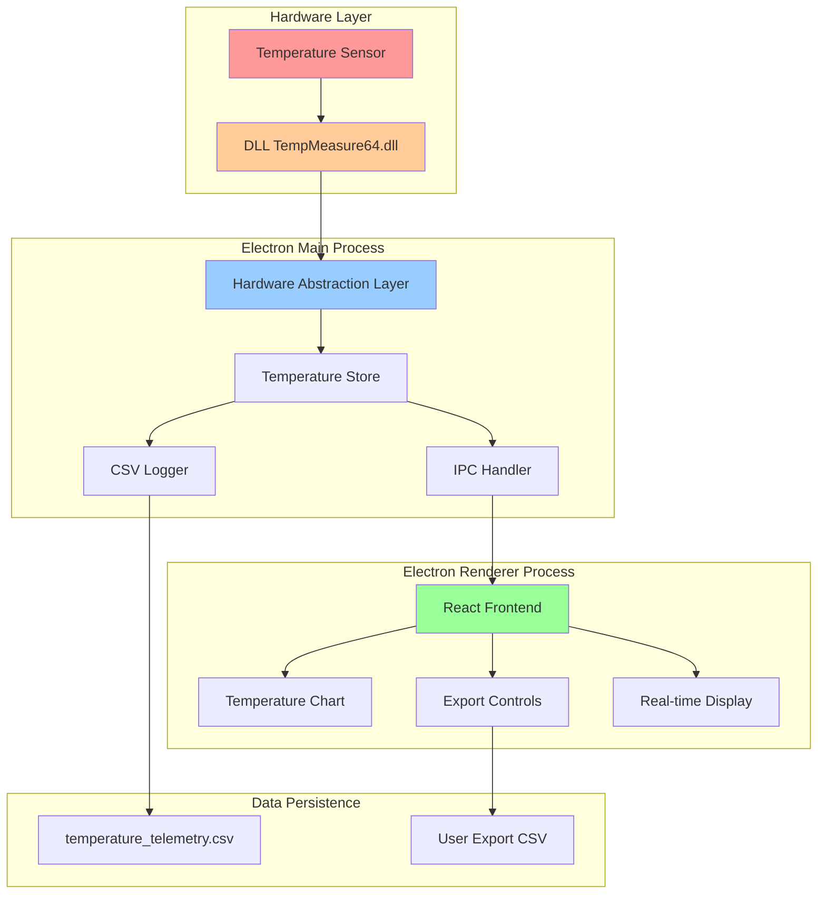
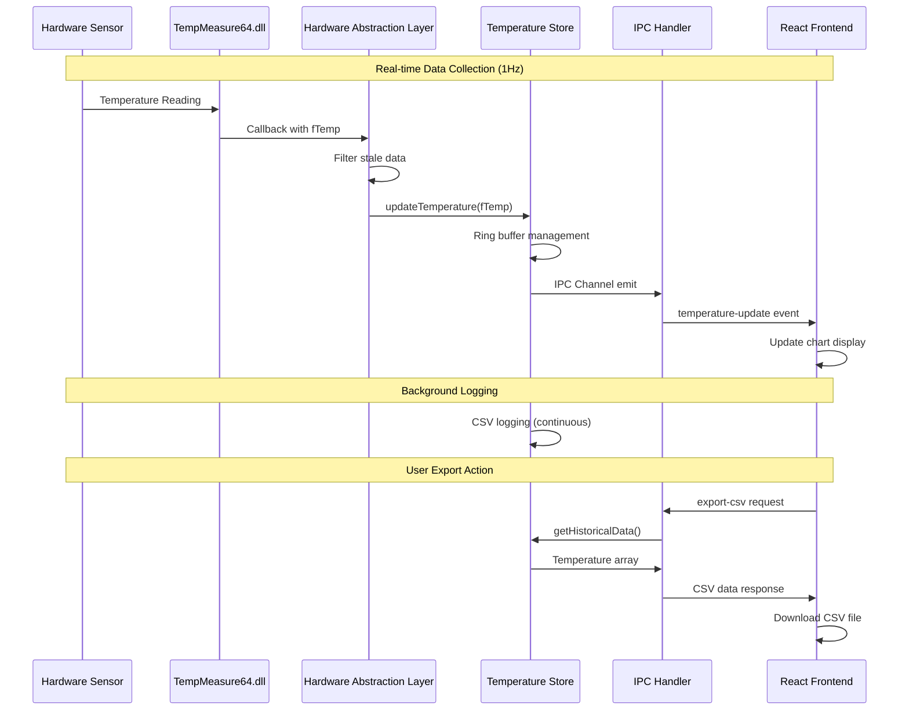
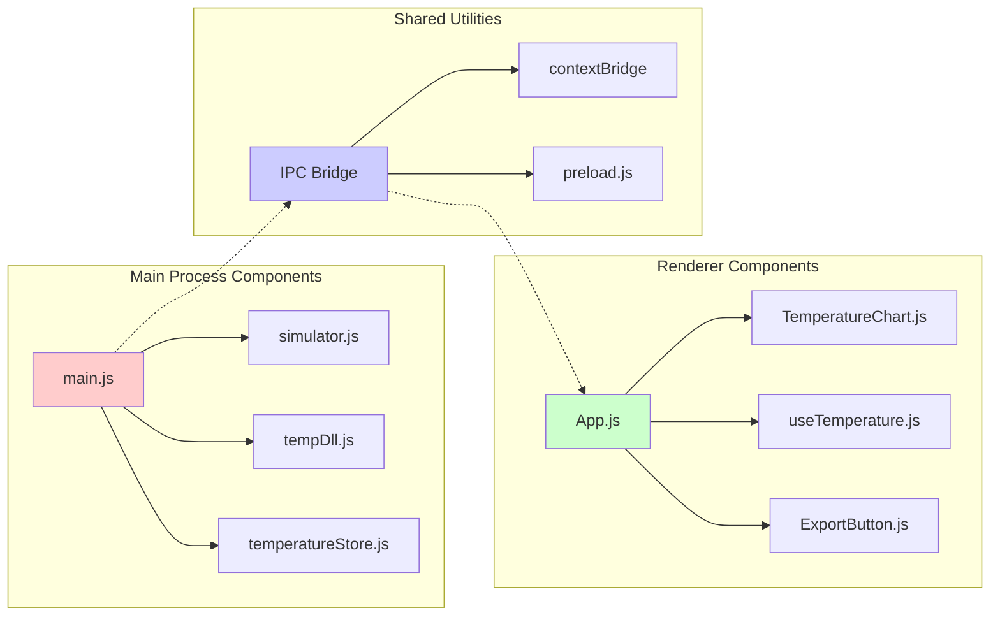
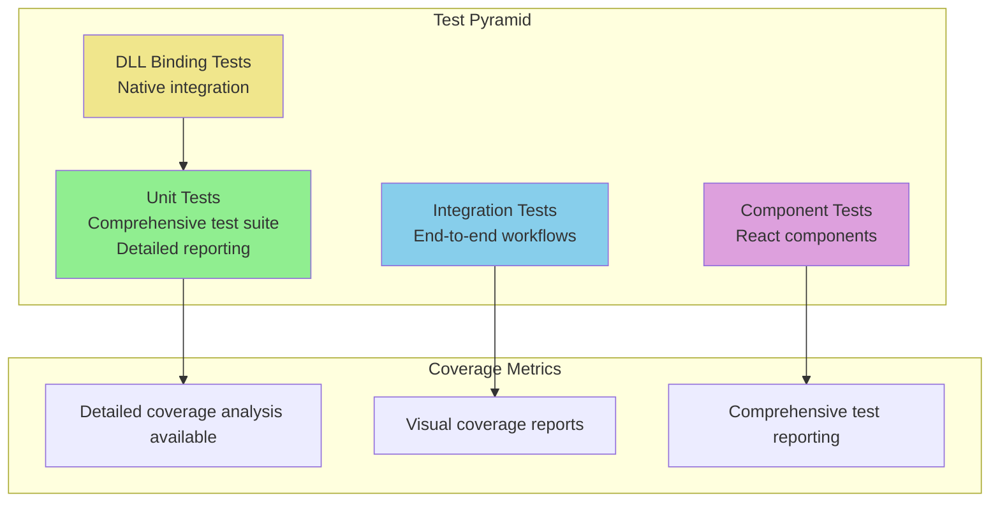
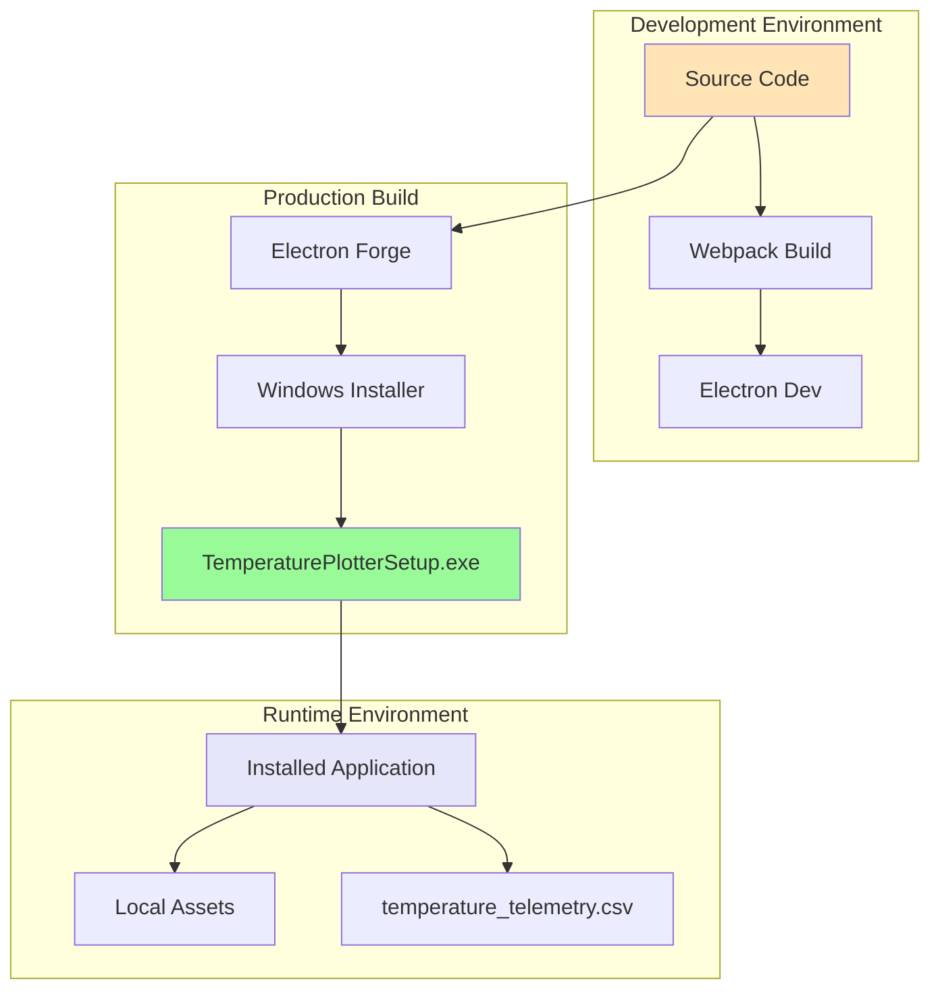

# System Architecture Design Artefacts
## Portfolio Evidence - Design Thinking and Planning

### 1. High-Level System Architecture

### 2. Data Flow Sequence

### 3. Component Architecture

### 4. Testing Strategy

### 5. Deployment Architecture

## Design Rationale

### Hardware Abstraction Layer (HAL)
- **Purpose**: Isolate hardware-specific code from business logic
- **Benefit**: Enables seamless switching between simulation and real hardware
- **KSB Demonstration**: S7 (Problem solving), K11 (Software designs)

### IPC Architecture
- **Purpose**: Secure communication between Node.js backend and React frontend
- **Implementation**: contextBridge for security, preload script for API exposure
- **KSB Demonstration**: K8 (Security), S2 (Effective user interfaces)

### Ring Buffer Data Structure
- **Purpose**: Memory-efficient storage of temperature history
- **Implementation**: Fixed-size circular buffer with automatic overflow handling
- **KSB Demonstration**: K9 (Data structures), S16 (Algorithms and logic)

### Testing Strategy
- **Purpose**: Ensure reliability and maintainability
- **Implementation**: Comprehensive test suite with mocking and coverage reporting
- **KSB Demonstration**: S4 (Unit testing), S5 (Integration testing), S13 (Testing frameworks)

## Portfolio Evidence Mapping

| Design Decision | KSB Demonstrated | Evidence Location |
|----------------|------------------|-------------------|
| Mermaid Architecture Diagrams | K7 (Design patterns) | This document |
| Hardware Abstraction Layer | S7 (Problem solving) | `src/main/dll/tempDll.js` |
| IPC Security Implementation | K8 (Security) | `src/main/preload.js` |
| Comprehensive Test Suite | S4, S5, S13 (Testing) | `__tests__/` directory |
| Ring Buffer Data Structure | K9 (Data structures) | `src/main/state/temperatureStore.js` |
| Semantic Git History | S14 (Version control) | Git commit history |

Created: February 2026
Purpose: Portfolio Evidence - Design Thinking and Software Architecture
