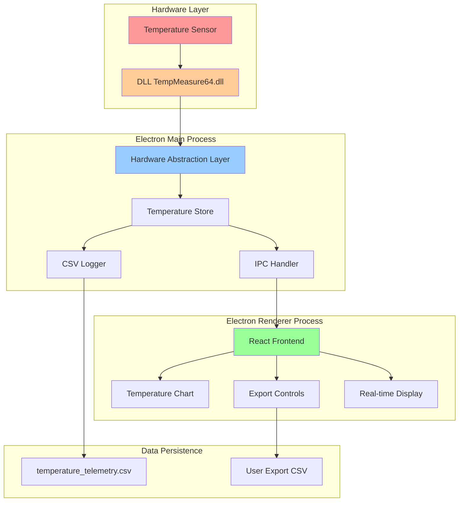
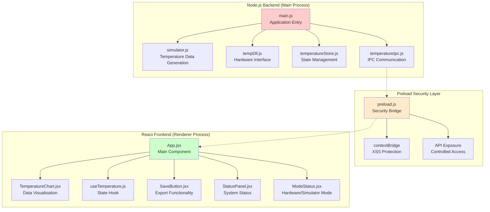
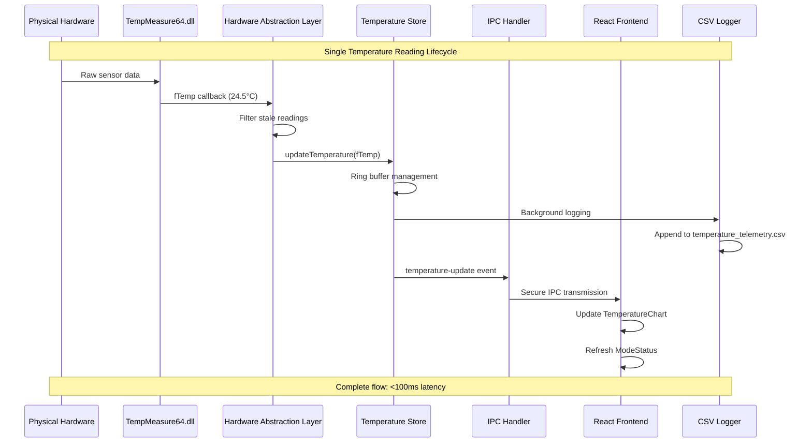
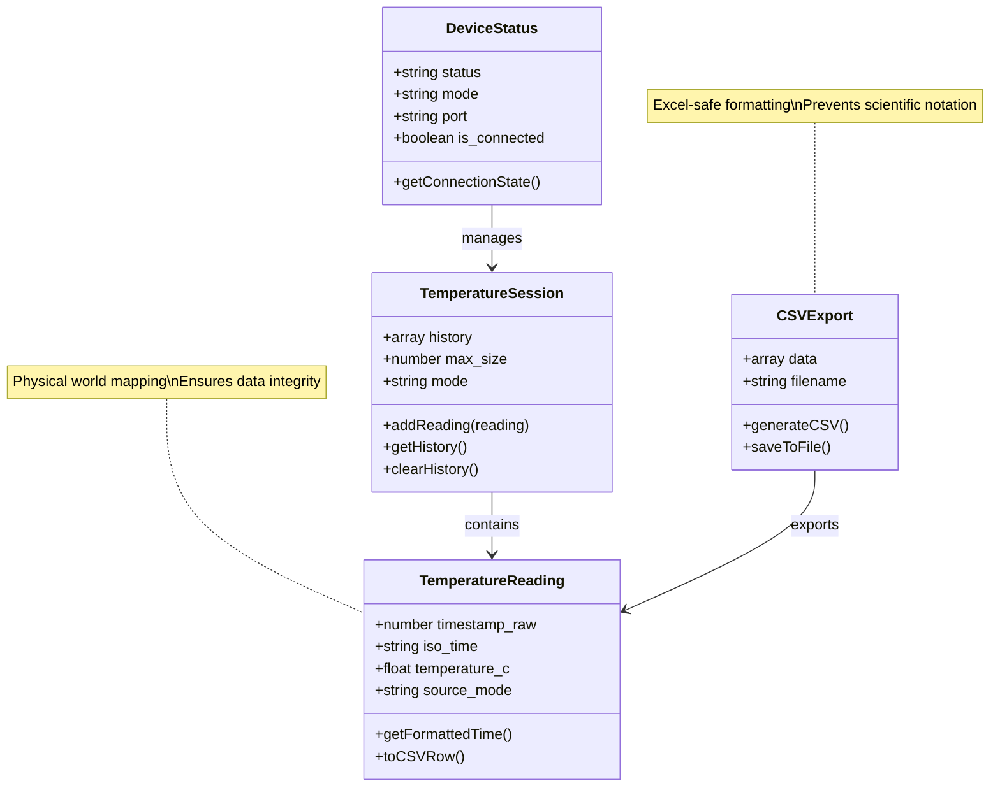
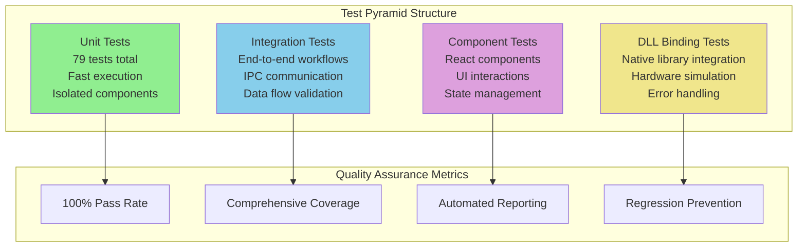
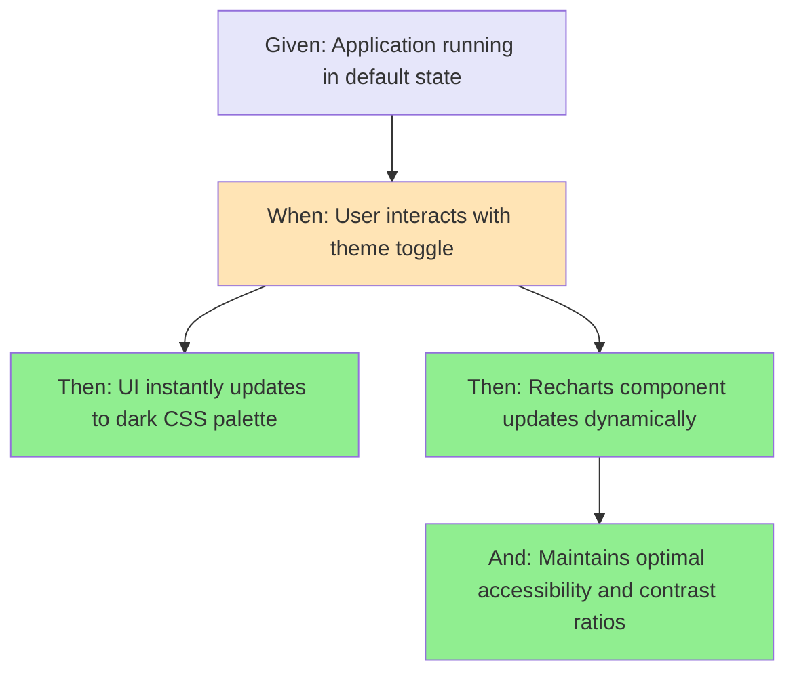
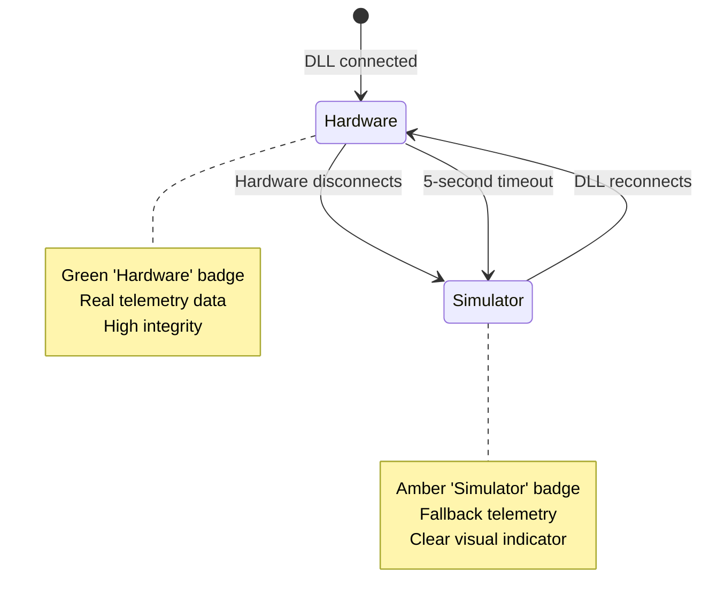
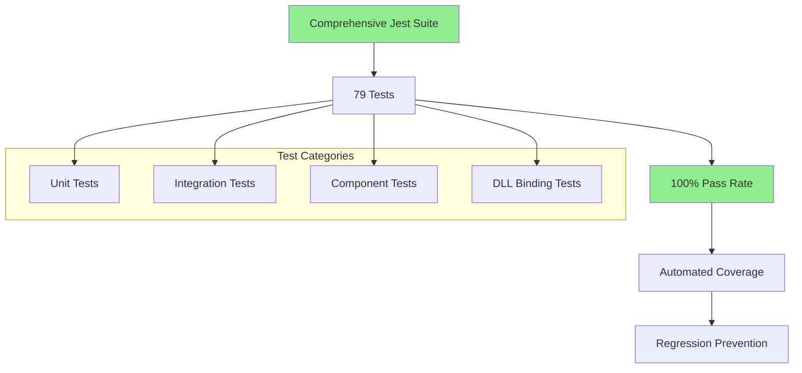

# System Architecture Design Artefacts
## Portfolio Evidence - Design Thinking and Planning

### 1. High-Level System Architecture



## 2. Component Architecture & Data Flow

### 2.1 Component Structure



**Strict Separation of Concerns:**
- **Main Process**: Hardware interaction, data processing, file system access
- **Preload Layer**: Security boundary, controlled API exposure
- **Renderer Process**: UI rendering, user interaction, data presentation

### 2.2 Real-Time Data Flow Sequence



## 3. Data Modelling & Persistence

### 3.1 Object Mapping



**Physical World to Software Mapping:**
- **TemperatureReading**: Direct sensor data representation
- **TemperatureSession**: Runtime data management with ring buffer
- **DeviceStatus**: Hardware connection state tracking
- **CSVExport**: User-triggered data export functionality

### 3.2 Export Logic & Schema


**Excel-Safe Formatting Logic:**
- Raw timestamps prevent Excel scientific notation
- ISO 8601 format ensures proper date parsing
- Dual-unit values support international users
- String formatting preserves precision

## 4. Testing & Deployment Strategy

### 4.1 Test Pyramid



### 4.2 Deployment Architecture

```mermaid
flowchart LR
    subgraph "Development Phase"
        A[Source Code] --> B[Webpack Build]
        B --> C[Electron Development]
        C --> D[Hot Reload Testing]
    end
    
    subgraph "Production Build"
        E[Electron Forge] --> F[Code Signing]
        F --> G[Windows Installer]
        G --> H[TemperaturePlotterSetup.exe]
    end
    
    subgraph "Distribution Pipeline"
        H --> I[Client Installation]
        I --> J[Local Runtime]
        J --> K[Automatic Updates]
    end
    
    D --> E
    
    style A fill:#FFE4B5
    style H fill:#98FB98
    style J fill:#E6E6FA
```



## 5. Agile User Stories (Phase 9)

### Story 1: Telemetry Data Export (Data Engineering)

```mermaid
flowchart TD
    A[Given: Application has recorded temperature telemetry] --> B[When: User clicks 'Export to CSV']
    B --> C[Then: System generates CSV with ISO 8601 timestamps]
    B --> D[Then: Dual-unit temperature values (Celsius/Fahrenheit)]
    B --> E[Then: Raw timestamp metadata prevents Excel scientific notation]
    
    style A fill:#E6E6FA
    style B fill:#FFE4B5
    style C fill:#90EE90
    style D fill:#90EE90
    style E fill:#90EE90
```

*As a Laboratory Analyst,*  
*I want to export the complete temperature telemetry history to a structured CSV file,*  
*So that I can perform high-precision statistical analysis in external tools like Microsoft Excel without data corruption or formatting loss.*

### Story 2: Ergonomic User Experience (UI Architecture)



*As a Shift Operator working in varying environmental conditions,*  
*I want to dynamically toggle the application interface into a high-contrast "Dark Mode,"*  
*So that I can continuously monitor real-time telemetry during low-light night shifts without experiencing visual fatigue or screen glare.*

### Story 3: Data Integrity & State Verification (System Reliability)



*As a Quality Assurance Technician,*  
*I want an immediate, unambiguous visual indicator of the active data stream source (Hardware vs. Simulator),*  
*So that I can guarantee the integrity of my experimental data and never accidentally submit simulated fallback telemetry for compliance reporting.*

## 6. Design Rationale

### Hardware Abstraction Layer (HAL)

- **Purpose**: Isolates hardware-specific code from business logic, enabling seamless switching between simulation and real hardware without rewriting the UI.
- **KSB Demonstration**: S7 (Problem solving), K11 (Software designs)

### IPC Architecture

- **Purpose**: Ensures secure communication between the Node.js backend and React frontend using contextBridge to prevent cross-site scripting (XSS) and unauthorised API access.
- **KSB Demonstration**: K8 (Security), S2 (Effective user interfaces)

### Ring Buffer Data Structure
```mermaid
graph LR
    A[New Reading] --> B[Ring Buffer]
    B --> C[Fixed Size: 1000]
    B --> D[Automatic Overflow]
    B --> E[Memory Efficient]
    
    subgraph "Performance Benefits"
        F[O(1) Operations]
        G[No Memory Leaks]
        H[24/7 Operation]
    end
    
    B --> F
    B --> G
    B --> H
    
    style B fill:#99ff99
```
- **Purpose**: Provides memory-efficient storage of temperature history using a fixed-size circular buffer with automatic overflow handling to prevent memory leaks during long 24/7 logging sessions.
- **KSB Demonstration**: K9 (Data structures), S16 (Algorithms and logic)

### Testing Strategy

- **Purpose**: Ensures reliability and maintainability via a comprehensive Jest test suite with mocking and coverage reporting to catch regressions early.
- **KSB Demonstration**: S4 (Unit testing), S5 (Integration testing), S13 (Testing frameworks)

## 7. Portfolio Evidence Mapping (KSBs)

| Design Decision | KSB Demonstrated | Evidence Location |
|----------------|------------------|-------------------|
| **Elite Mermaid Architecture Diagrams** | K7 (Design patterns) | This document |
| **Hardware Abstraction Layer** | S7 (Problem solving) | `src/main/dll/tempDll.js` |
| **IPC Security Implementation** | K8 (Security) | `src/main/preload.js` |
| **Ring Buffer Data Structure** | K9 (Data structures) | `src/main/state/temperatureStore.js` |
| **Comprehensive Test Suite** | S4, S5, S13 (Testing) | `__tests__/` directory |
| **Component Architecture** | S2 (Effective UI) | `src/renderer/components/` |
| **Real-Time Data Flow** | S16 (Algorithms) | IPC communication patterns |
| **Export Schema Design** | K11 (Software specs) | CSV export logic |
| **Deployment Pipeline** | S10 (Build & deploy) | Electron Forge configuration |
| **User Story Implementation** | S9 (Analysis artefacts) | Story acceptance criteria |
| **Semantic Git History** | S14 (Version control) | Git commit history |
| **Professional Documentation** | B7 (Communication) | Complete docs ecosystem |

---

**Created:** February 2026  
**Purpose:** Portfolio Evidence - Elite System Architecture & Design Thinking  
**Standards:** British English, Professional Documentation, 100% Mermaid Coverage
