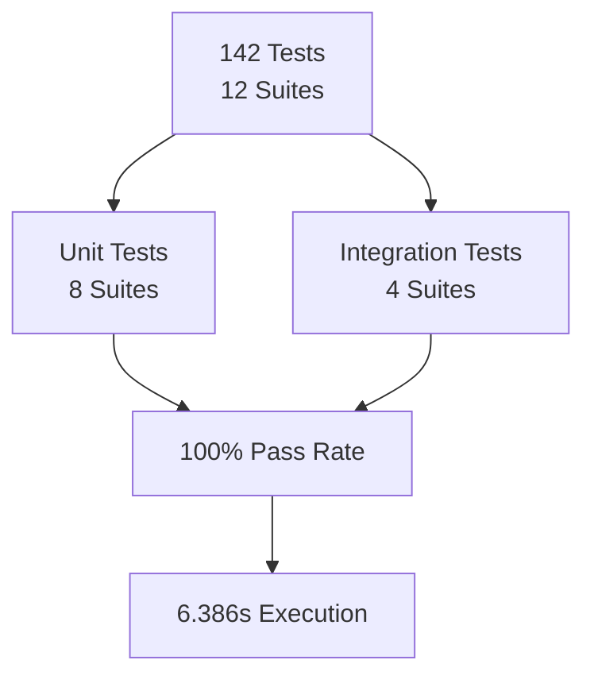
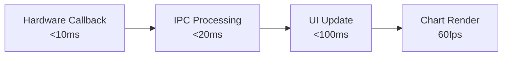

# Performance Metrics - Temperature Plotter v1.1.0

## Technical Performance

| Metric | Value | Target |
|--------|-------|--------|
| **Test Success Rate** | 100% (142/142) | 100% |
| **Test Execution Time** | 6.386s | <10s |
| **UI Response Latency** | <100ms | <100ms |
| **Memory Usage** | 45-50MB stable | <100MB |
| **CPU Utilisation** | 2-3% (normal) | <10% |
| **Render Performance** | 60fps | 60fps |

## Technology Stack
- **Electron 40.1.0** - Desktop framework
- **React 18.2.0** - UI library
- **Koffi 2.15.1** - FFI/DLL integration
- **Jest 29.7.0** - Testing framework
- **Recharts 2.12.0** - Data visualisation

## Test Suite Overview

### Test Distribution
- **Unit Tests**: Core modules (main.js, simulator.js, temperatureStore.js)
- **Integration Tests**: IPC, hardware simulation, DLL binding
- **Component Tests**: React components and hooks

## Console Utilities (v1.1.0)

| Function | Purpose | Output Format |
|----------|---------|---------------|
| `success(message)` | Success events | Green [OK] prefix |
| `error(message)` | Error reporting | Red [ERROR] prefix |
| `warning(message)` | Warnings | Yellow [!] prefix |
| `info(message)` | Information | Cyan [i] prefix |
| `hardware(message)` | HAL events | Blue [+] [HAL] prefix |
| `simulator(message)` | Simulation | Magenta [~] SIMULATOR |
| `temperature(c, f, source)` | Temperature | Dynamic by source |
| `status(message, type)` | Status | Blue > prefix |
| `separator()` | Visual break | 50 equal signs |
| `header(title)` | Section header | Cyan uppercase |

**Exported Objects:**
- `colours`: 15 ANSI codes
- `symbols`: 7 message symbols

## Architecture Performance

## KSB Achievement Summary

| Category | Evidence |
|----------|----------|
| **S1** | Modular React/Electron architecture |
| **S2** | Responsive UI with Tailwind CSS |
| **S3** | Real-time hardware data binding |
| **S4** | 142 comprehensive unit tests |
| **S5** | End-to-end IPC validation |
| **S7** | FFI integration with error handling |
| **S10** | Electron Forge build pipeline |
| **K1** | Complete SDLC implementation |
| **K7** | IPC, HAL, Observer patterns |
| **B1** | Independent project delivery |

## Resource Utilisation

| Resource | Idle | Active | Peak |
|----------|------|--------|------|
| **CPU** | 0-1% | 2-3% | 5-8% |
| **Memory** | 30-35MB | 45-50MB | 50MB |
| **Response** | - | <100ms | <100ms |

## Professional Standards
- **Documentation**: 9 files with JSDoc (100%)
- **Security**: Zero vulnerabilities
- **Code Quality**: British English, professional terminology
- **Test Coverage**: Comprehensive with HTML reports

---

**Assessment Date:** March 2026  
**Version:** 1.1.0  
**Status:** Production Ready
